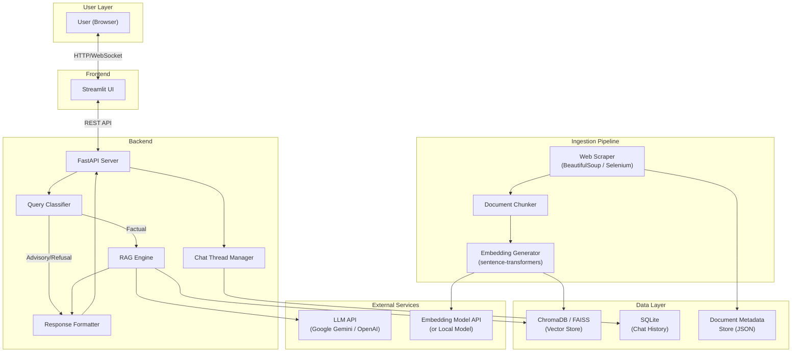
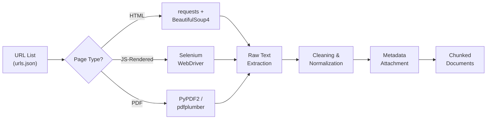
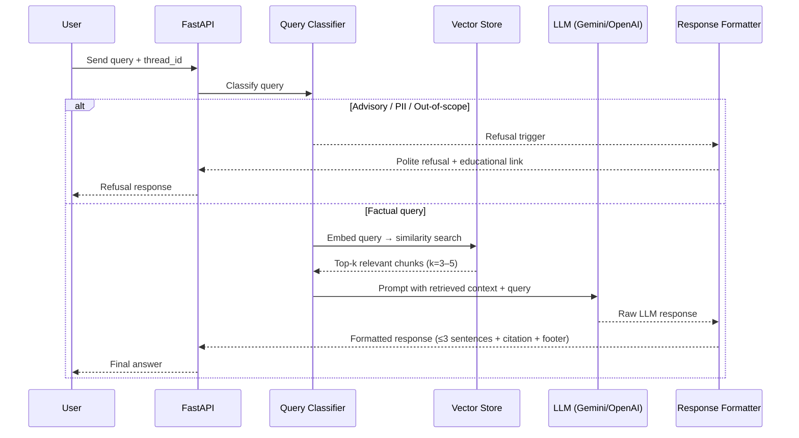
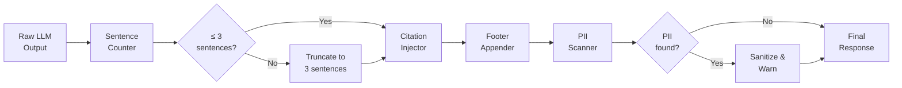
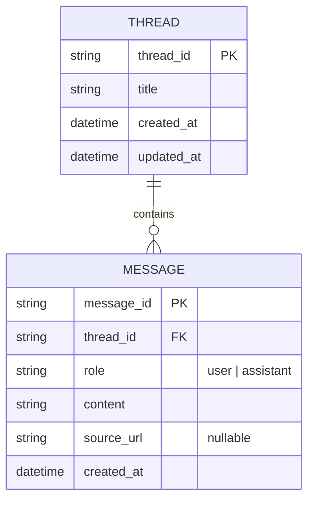
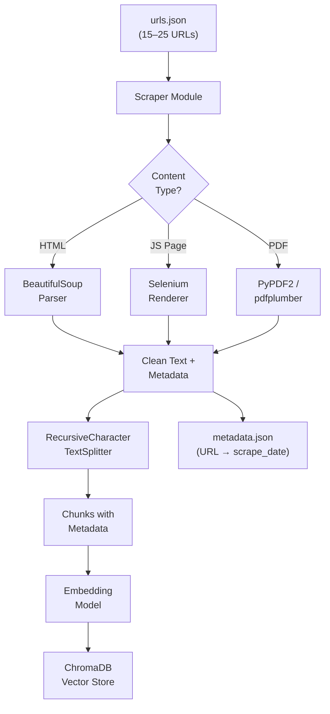
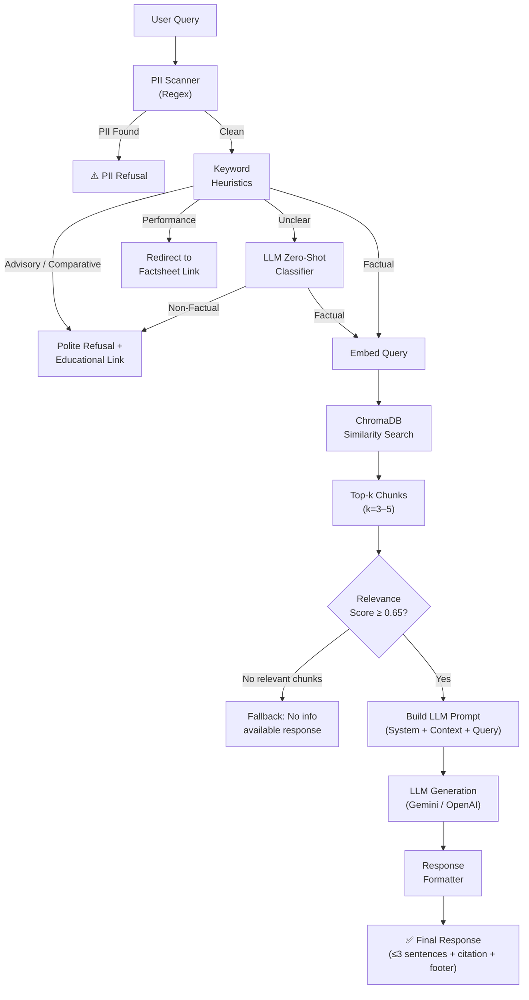
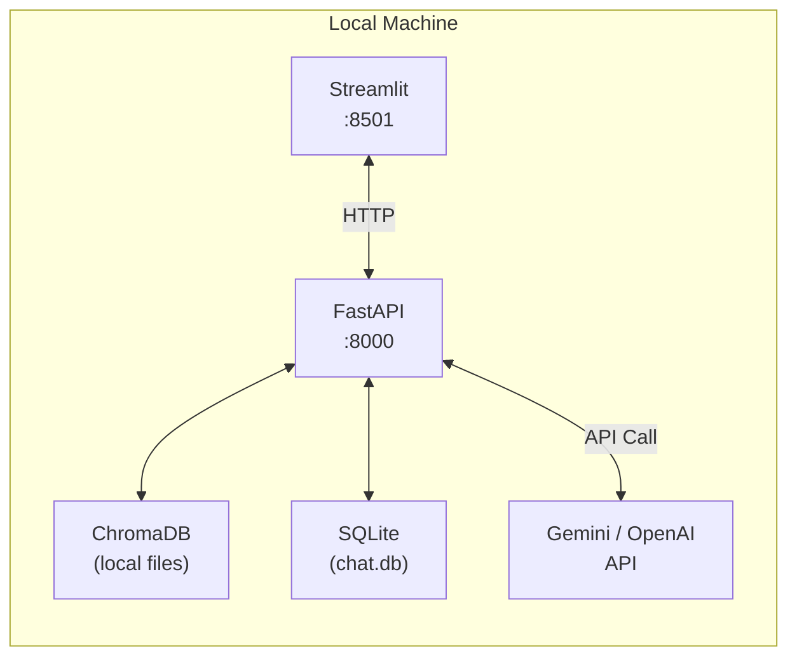

# Architecture: Mutual Fund FAQ Assistant (Facts-Only Q&A)

> **Project:** RAG-based Facts-Only Mutual Fund FAQ Assistant  
> **AMC:** HDFC Mutual Fund (HDFC AMC)  
> **Reference Context:** Groww  
> **Version:** 1.0  
> **Last Updated:** 2026-10-25

---

## Table of Contents

1. [High-Level Architecture](#1-high-level-architecture)
2. [System Components](#2-system-components)
3. [Data Ingestion Pipeline](#3-data-ingestion-pipeline)
4. [RAG Pipeline](#4-rag-pipeline)
5. [Query Classification & Safety Layer](#5-query-classification--safety-layer)
6. [Response Generation & Formatting](#6-response-generation--formatting)
7. [Multi-Thread Chat Management](#7-multi-thread-chat-management)
8. [Frontend Architecture](#8-frontend-architecture)
9. [Project Structure](#9-project-structure)
10. [Tech Stack](#10-tech-stack)
11. [API Design](#11-api-design)
12. [Data Flow Diagrams](#12-data-flow-diagrams)
13. [Configuration & Environment](#13-configuration--environment)
14. [Security & Privacy Guardrails](#14-security--privacy-guardrails)
15. [Deployment Architecture](#15-deployment-architecture)
16. [Known Limitations & Assumptions](#16-known-limitations--assumptions)

---

## 1. High-Level Architecture

The system follows a **Retrieval-Augmented Generation (RAG)** architecture with a safety classification layer. At its core, the assistant:

1. **Scrapes & ingests** official public documents (factsheets, KIM, SID, AMC/AMFI/SEBI pages) into a vector store.
2. **Classifies** incoming user queries as factual (answerable) or advisory/out-of-scope (refusable).
3. **Retrieves** the most relevant document chunks from the vector database using semantic similarity search.
4. **Generates** a concise, facts-only response grounded strictly in retrieved context, with a citation link and last-updated footer.



---

## 2. System Components

### 2.1. Component Overview

| Component | Responsibility | Technology |
| :--- | :--- | :--- |
| **Web Scraper** | Fetches content from official AMC, AMFI, SEBI, and Groww URLs | `requests`, `BeautifulSoup4`, `Selenium` (for JS-rendered pages) |
| **Document Chunker** | Splits scraped documents into semantically coherent chunks with metadata | `langchain.text_splitter` (RecursiveCharacterTextSplitter) |
| **Embedding Generator** | Converts text chunks into dense vector embeddings | `sentence-transformers` (`all-MiniLM-L6-v2`) or Google `text-embedding-004` |
| **Vector Store** | Stores and indexes embeddings for fast similarity search | `ChromaDB` (primary) or `FAISS` (alternative) |
| **Query Classifier** | Determines if a query is factual, advisory, PII-containing, or out-of-scope | LLM-based zero-shot classification + keyword heuristics |
| **RAG Engine** | Orchestrates retrieval + generation; fetches relevant chunks and passes them as context to the LLM | `LangChain` / custom retrieval chain |
| **Response Formatter** | Enforces the 3-sentence limit, attaches exactly one citation link, appends the last-updated footer | Custom post-processing module |
| **Chat Thread Manager** | Manages multiple independent conversation threads with isolated histories | `SQLite` + in-memory session store |
| **FastAPI Backend** | Serves the REST API; handles routing, session management, and CORS | `FastAPI`, `Uvicorn` |
| **Streamlit Frontend** | Provides the minimal chat UI with welcome message, examples, and disclaimer | `Streamlit` |

---

## 3. Data Ingestion Pipeline

The ingestion pipeline runs **offline** (or on a scheduled basis) to build and refresh the vector store from official public sources.

### 3.1. Source URLs

The corpus is built from the following categories of official sources:

| # | Source Category | Example URLs | Count Target |
| :--- | :--- | :--- | :--- |
| 1 | Groww Scheme Pages | `https://groww.in/mutual-funds/hdfc-mid-cap-fund-direct-growth` (and 4 others) | 5 |
| 2 | HDFC AMC Official Factsheets | `https://www.hdfcfund.com/mutual-funds/equity/mid-cap-fund` | 5 |
| 3 | KIM / SID Documents (PDF) | HDFC AMC document library links | 3–5 |
| 4 | HDFC AMC FAQ / Help Pages | `https://www.hdfcfund.com/investor-services/...` | 2–3 |
| 5 | AMFI Guidance Pages | `https://www.amfiindia.com/investor-corner/...` | 2–3 |
| 6 | SEBI Investor Education | `https://investor.sebi.gov.in/...` | 2–3 |
| 7 | Statement/Tax Download Guides | AMC help pages for CAS, capital gains reports | 1–2 |
|   | **Total** | | **15–25** |

### 3.2. Scraping Strategy



- **HTML pages:** Use `requests` + `BeautifulSoup4` for static pages.
- **JavaScript-rendered pages** (e.g., Groww): Use `Selenium` with headless Chrome to wait for dynamic content.
- **PDF documents** (KIM, SID): Use `PyPDF2` or `pdfplumber` to extract text.
- **Metadata captured per source:** `source_url`, `document_type` (factsheet/KIM/SID/FAQ/guide), `scheme_name`, `amc`, `scrape_date`.

### 3.3. Chunking Strategy

| Parameter | Value | Rationale |
| :--- | :--- | :--- |
| **Splitter** | `RecursiveCharacterTextSplitter` | Handles nested structure (headings, paragraphs, lists) |
| **Chunk Size** | 500–800 characters | Balances granularity vs. context completeness |
| **Chunk Overlap** | 100–150 characters | Preserves continuity at chunk boundaries |
| **Metadata per Chunk** | `source_url`, `scheme_name`, `document_type`, `section_heading`, `scrape_date` | Enables precise citation and filtering |

### 3.4. Embedding & Indexing

```python
# Pseudocode — Embedding & Indexing
from sentence_transformers import SentenceTransformer
import chromadb

model = SentenceTransformer("all-MiniLM-L6-v2")  # 384-dim embeddings
client = chromadb.PersistentClient(path="./data/vectorstore")
collection = client.get_or_create_collection(
    name="mf_faq_corpus",
    metadata={"hnsw:space": "cosine"}
)

for chunk in chunked_documents:
    embedding = model.encode(chunk.text)
    collection.add(
        ids=[chunk.id],
        embeddings=[embedding.tolist()],
        documents=[chunk.text],
        metadatas=[chunk.metadata]  # source_url, scheme_name, etc.
    )
```

| Parameter | Choice |
| :--- | :--- |
| **Embedding Model** | `all-MiniLM-L6-v2` (local, 384 dim) or `text-embedding-004` (Google API, 768 dim) |
| **Vector Store** | ChromaDB with persistent storage |
| **Distance Metric** | Cosine similarity |
| **Index Type** | HNSW (default in ChromaDB) |

---

## 4. RAG Pipeline

### 4.1. Retrieval Phase



### 4.2. Retrieval Parameters

| Parameter | Value | Notes |
| :--- | :--- | :--- |
| **Top-k** | 3–5 chunks | Retrieve the 3–5 most similar chunks |
| **Similarity Threshold** | ≥ 0.65 cosine similarity | Discard low-relevance chunks |
| **Metadata Filtering** | Optional: filter by `scheme_name` if detected in query | Improves precision for scheme-specific questions |
| **Re-ranking** | Optional: cross-encoder re-ranker (`ms-marco-MiniLM-L-6-v2`) | For improved relevance ordering |

### 4.3. Generation Phase — Prompt Template

```text
SYSTEM PROMPT:
You are a facts-only mutual fund FAQ assistant for HDFC Mutual Fund schemes 
on the Groww platform. You MUST follow these rules strictly:

1. Answer ONLY factual, objective questions about mutual fund schemes.
2. Base your answer EXCLUSIVELY on the provided context. Do NOT hallucinate.
3. Keep your response to a MAXIMUM of 3 sentences.
4. Include EXACTLY ONE source citation link from the context metadata.
5. End every response with: "Last updated from sources: {scrape_date}"
6. NEVER provide investment advice, opinions, comparisons, or recommendations.
7. If the context does not contain enough information, say:
   "I don't have verified information on this. Please check the official 
   HDFC AMC website: https://www.hdfcfund.com"

CONTEXT (Retrieved from official sources):
---
{retrieved_chunks_with_source_urls}
---

USER QUERY: {user_query}

ASSISTANT:
```

---

## 5. Query Classification & Safety Layer

### 5.1. Classification Categories

| Category | Action | Examples |
| :--- | :--- | :--- |
| **FACTUAL** | Proceed with RAG retrieval + generation | "What is the expense ratio of HDFC Mid Cap Fund?" |
| **ADVISORY** | Refuse politely; provide educational link | "Should I invest in HDFC Small Cap Fund?" |
| **COMPARATIVE** | Refuse politely; provide educational link | "Which is better — Mid Cap or Large Cap?" |
| **PII_DETECTED** | Refuse immediately; warn about PII | "My PAN is ABCDE1234F, check my portfolio" |
| **OUT_OF_SCOPE** | Refuse politely; redirect | "What's the weather today?" |
| **PERFORMANCE** | Redirect to official factsheet link only | "What are the returns of HDFC Multi Cap Fund?" |

### 5.2. Classification Implementation

A **two-layer classification** approach:

**Layer 1 — Keyword & Pattern Heuristics (Fast, No API Call):**
```python
ADVISORY_KEYWORDS = [
    "should i", "recommend", "better", "best", "suggest",
    "worth it", "good fund", "invest in", "which fund",
    "outperform", "predict", "will it"
]

PII_PATTERNS = [
    r"\b[A-Z]{5}\d{4}[A-Z]\b",       # PAN
    r"\b\d{12}\b",                     # Aadhaar
    r"\b\d{9,18}\b",                   # Account numbers
    r"\b\d{4,6}\b.*OTP",               # OTP
    r"[\w.+-]+@[\w-]+\.[\w.-]+",       # Email
    r"\b[6-9]\d{9}\b"                  # Indian phone number
]

PERFORMANCE_KEYWORDS = [
    "return", "returns", "performance", "cagr", "growth",
    "annualized", "profit", "loss", "nav history"
]
```

**Layer 2 — LLM-Based Zero-Shot Classification (For Ambiguous Queries):**
- If Layer 1 is inconclusive, pass the query to the LLM with a classification-specific prompt.
- The LLM returns one of: `FACTUAL`, `ADVISORY`, `COMPARATIVE`, `PERFORMANCE`, `OUT_OF_SCOPE`.

### 5.3. Refusal Response Templates

```python
REFUSAL_TEMPLATES = {
    "ADVISORY": (
        "I'm a facts-only assistant and cannot provide investment advice or "
        "recommendations. For investment guidance, consider consulting a "
        "SEBI-registered financial advisor. Learn more: "
        "https://investor.sebi.gov.in/"
    ),
    "COMPARATIVE": (
        "I can only share factual details about individual schemes and cannot "
        "compare funds or suggest which is better. You can review each scheme's "
        "factsheet on the HDFC AMC website: https://www.hdfcfund.com"
    ),
    "PII_DETECTED": (
        "⚠️ Please do not share personal information such as PAN, Aadhaar, "
        "account numbers, or contact details. I do not collect or process "
        "personal data. For account-related queries, visit: "
        "https://www.hdfcfund.com/investor-services"
    ),
    "PERFORMANCE": (
        "I cannot provide return calculations or performance comparisons. "
        "For official performance data, please refer to the scheme factsheet: "
        "{factsheet_link}"
    ),
    "OUT_OF_SCOPE": (
        "This question is outside my scope. I can only answer factual questions "
        "about HDFC Mutual Fund schemes. To learn about mutual funds, visit: "
        "https://www.amfiindia.com/investor-corner/knowledge-center"
    )
}
```

---

## 6. Response Generation & Formatting

### 6.1. Post-Processing Pipeline



### 6.2. Formatting Rules (Enforced Programmatically)

```python
import re
from datetime import datetime

def format_response(raw_response: str, source_url: str, scrape_date: str) -> str:
    """Enforce response format constraints."""
    # 1. Split into sentences and cap at 3
    sentences = re.split(r'(?<=[.!?])\s+', raw_response.strip())
    capped = ' '.join(sentences[:3])

    # 2. Append citation
    citation = f"\n\n📎 Source: {source_url}"

    # 3. Append last-updated footer
    footer = f"\n\n_Last updated from sources: {scrape_date}_"

    # 4. Scan for leaked PII (final safety net)
    if contains_pii(capped):
        return REFUSAL_TEMPLATES["PII_DETECTED"]

    return capped + citation + footer
```

---

## 7. Multi-Thread Chat Management

### 7.1. Thread Architecture

Each user can have multiple independent chat threads. Threads are isolated — no context leaks between them.



### 7.2. Storage — SQLite Schema

```sql
CREATE TABLE IF NOT EXISTS threads (
    thread_id   TEXT PRIMARY KEY,
    title       TEXT NOT NULL DEFAULT 'New Chat',
    created_at  TIMESTAMP DEFAULT CURRENT_TIMESTAMP,
    updated_at  TIMESTAMP DEFAULT CURRENT_TIMESTAMP
);

CREATE TABLE IF NOT EXISTS messages (
    message_id  TEXT PRIMARY KEY,
    thread_id   TEXT NOT NULL,
    role        TEXT NOT NULL CHECK(role IN ('user', 'assistant')),
    content     TEXT NOT NULL,
    source_url  TEXT,
    created_at  TIMESTAMP DEFAULT CURRENT_TIMESTAMP,
    FOREIGN KEY (thread_id) REFERENCES threads(thread_id) ON DELETE CASCADE
);

CREATE INDEX idx_messages_thread ON messages(thread_id, created_at);
```

### 7.3. Thread Manager Module

```python
# chat_manager.py — Key operations
class ChatThreadManager:
    def create_thread(self, title: str = "New Chat") -> str: ...
    def list_threads(self) -> list[Thread]: ...
    def get_thread_history(self, thread_id: str) -> list[Message]: ...
    def add_message(self, thread_id: str, role: str, content: str, source_url: str = None): ...
    def delete_thread(self, thread_id: str): ...
    def rename_thread(self, thread_id: str, title: str): ...
```

> [!NOTE]
> Chat history is **not** passed into the RAG retrieval context. Each query is treated independently for retrieval. However, the chat history is displayed in the UI for user reference and is available for optional conversational continuity at the LLM prompt level.

---

## 8. Frontend Architecture

### 8.1. Streamlit UI Layout

```
┌──────────────────────────────────────────────────────────┐
│  🏦 Mutual Fund FAQ Assistant    ⚠️ Facts-only. No      │
│     (HDFC Mutual Fund)              investment advice.   │
├──────────────┬───────────────────────────────────────────┤
│              │                                           │
│  📋 Threads  │  💬 Chat Area                             │
│              │                                           │
│  + New Chat  │  Welcome! I can answer factual questions  │
│              │  about HDFC Mutual Fund schemes.          │
│  ─────────── │                                           │
│  Thread 1    │  Try asking:                              │
│  Thread 2    │  • "What is the expense ratio of HDFC     │
│  Thread 3    │     Mid Cap Fund Direct Growth?"          │
│              │  • "What is the exit load for HDFC        │
│              │     Small Cap Fund?"                      │
│              │  • "What is the minimum SIP amount for    │
│              │     HDFC Large Cap Fund?"                 │
│              │                                           │
│              │  ┌─────────────────────────────────┐      │
│              │  │  Type your question...     ➤    │      │
│              │  └─────────────────────────────────┘      │
└──────────────┴───────────────────────────────────────────┘
```

### 8.2. UI Components

| Component | Description |
| :--- | :--- |
| **Header** | App title + persistent disclaimer badge |
| **Thread Sidebar** | List of chat threads + "New Chat" button |
| **Chat Area** | Scrollable message history for the active thread |
| **Welcome Card** | Shown on empty threads; includes 3 example questions as clickable buttons |
| **Input Bar** | Text input at the bottom with send button |
| **Loading Spinner** | Shown during retrieval + generation |

---

## 9. Project Structure

```
Milestone2/
├── Docs/
│   ├── Problem Statement.txt
│   ├── problemstatement.md
│   └── architecture.md              ← This file
│
├── app/
│   ├── main.py                      # FastAPI app entrypoint
│   ├── config.py                    # Environment & config loader
│   │
│   ├── ingestion/
│   │   ├── __init__.py
│   │   ├── scraper.py               # Web scraper (BS4 + Selenium)
│   │   ├── pdf_parser.py            # PDF text extraction
│   │   ├── chunker.py               # Document chunking logic
│   │   ├── embedder.py              # Embedding generation
│   │   └── indexer.py               # Vector store indexing
│   │
│   ├── core/
│   │   ├── __init__.py
│   │   ├── classifier.py            # Query classification (heuristic + LLM)
│   │   ├── retriever.py             # Vector similarity search
│   │   ├── generator.py             # LLM prompt + response generation
│   │   ├── formatter.py             # Response formatting (3 sentences, citation, footer)
│   │   └── safety.py                # PII detection, refusal templates
│   │
│   ├── chat/
│   │   ├── __init__.py
│   │   ├── manager.py               # Chat thread CRUD (SQLite)
│   │   └── models.py                # Pydantic models for threads/messages
│   │
│   ├── api/
│   │   ├── __init__.py
│   │   └── routes.py                # FastAPI route definitions
│   │
│   └── prompts/
│       ├── system_prompt.txt         # System prompt template
│       ├── classification_prompt.txt # Classification prompt
│       └── refusal_templates.json    # Refusal response templates
│
├── frontend/
│   └── streamlit_app.py             # Streamlit chat UI
│
├── data/
│   ├── urls.json                    # Curated source URL list
│   ├── vectorstore/                 # ChromaDB persistent storage
│   ├── raw/                         # Raw scraped content
│   └── chat.db                      # SQLite chat history
│
├── scripts/
│   ├── ingest.py                    # Run full ingestion pipeline
│   └── reset_db.py                  # Reset vector store / chat DB
│
├── tests/
│   ├── test_classifier.py
│   ├── test_retriever.py
│   ├── test_formatter.py
│   └── test_refusal.py
│
├── .env.example                     # Environment variable template
├── requirements.txt                 # Python dependencies
├── README.md                        # Setup & usage guide
└── .gitignore
```

---

## 10. Tech Stack

| Layer | Technology | Version / Notes |
| :--- | :--- | :--- |
| **Language** | Python | 3.11+ |
| **Backend Framework** | FastAPI | Async REST API |
| **ASGI Server** | Uvicorn | Production-grade async server |
| **Frontend** | Streamlit | Rapid prototyping chat UI |
| **LLM** | Groq (`llama-3.3-70b-versatile` / `llama-3.1-8b-instant`) with Gemini/OpenAI fallback | Via API; ultra-low latency inference |
| **Embeddings** | `sentence-transformers/all-MiniLM-L6-v2` (local) or Google `text-embedding-004` | 384-dim / 768-dim |
| **Vector Store** | ChromaDB | Persistent, local, no infra overhead |
| **Relational DB** | SQLite | Chat history, zero setup |
| **Web Scraping** | `requests`, `BeautifulSoup4`, `Selenium` | Static + dynamic pages |
| **PDF Parsing** | `PyPDF2` / `pdfplumber` | KIM, SID documents |
| **Text Splitting** | LangChain `RecursiveCharacterTextSplitter` | Configurable chunk sizes |
| **Orchestration** | LangChain (optional) or custom pipeline | RAG chain assembly |
| **PII Detection** | Regex patterns + `presidio-analyzer` (optional) | Guardrail layer |

### 10.1. `requirements.txt`

```
fastapi>=0.110.0
uvicorn[standard]>=0.29.0
streamlit>=1.35.0
chromadb>=0.5.0
sentence-transformers>=3.0.0
langchain>=0.2.0
langchain-community>=0.2.0
langchain-google-genai>=1.0.0
google-generativeai>=0.7.0
beautifulsoup4>=4.12.0
selenium>=4.20.0
webdriver-manager>=4.0.0
pypdf2>=3.0.0
pdfplumber>=0.11.0
python-dotenv>=1.0.0
pydantic>=2.7.0
requests>=2.31.0
```

---

## 11. API Design

### 11.1. REST Endpoints

| Method | Endpoint | Description |
| :--- | :--- | :--- |
| `POST` | `/api/chat` | Send a query; receive a formatted response |
| `POST` | `/api/threads` | Create a new chat thread |
| `GET` | `/api/threads` | List all chat threads |
| `GET` | `/api/threads/{thread_id}` | Get messages for a specific thread |
| `DELETE` | `/api/threads/{thread_id}` | Delete a chat thread |
| `PATCH` | `/api/threads/{thread_id}` | Rename a thread |
| `GET` | `/api/health` | Health check endpoint |

### 11.2. Request / Response Schemas

**POST `/api/chat`**

```json
// Request
{
  "thread_id": "abc-123",
  "query": "What is the expense ratio of HDFC Mid Cap Fund Direct Growth?"
}

// Response — Factual
{
  "thread_id": "abc-123",
  "message_id": "msg-456",
  "query": "What is the expense ratio of HDFC Mid Cap Fund Direct Growth?",
  "response": "The expense ratio (TER) of HDFC Mid-Cap Opportunities Fund - Direct Growth is 0.74% as per the latest factsheet. This includes all fund management and operational costs borne by the investor.\n\n📎 Source: https://groww.in/mutual-funds/hdfc-mid-cap-fund-direct-growth\n\n_Last updated from sources: 2026-10-25_",
  "classification": "FACTUAL",
  "source_url": "https://groww.in/mutual-funds/hdfc-mid-cap-fund-direct-growth",
  "is_refusal": false
}

// Response — Refusal
{
  "thread_id": "abc-123",
  "message_id": "msg-789",
  "query": "Should I invest in HDFC Mid Cap Fund?",
  "response": "I'm a facts-only assistant and cannot provide investment advice or recommendations. For investment guidance, consider consulting a SEBI-registered financial advisor. Learn more: https://investor.sebi.gov.in/",
  "classification": "ADVISORY",
  "source_url": null,
  "is_refusal": true
}
```

---

## 12. Data Flow Diagrams

### 12.1. Ingestion Flow (Offline)



### 12.2. Query Flow (Online)



---

## 13. Configuration & Environment

### 13.1. `.env.example`

```env
# === LLM Configuration ===
LLM_PROVIDER=groq                      # "groq", "google", or "openai"
GROQ_API_KEY=your-groq-api-key
GROQ_MODEL=llama-3.3-70b-versatile
LLM_MODEL=llama-3.3-70b-versatile
GOOGLE_API_KEY=your-gemini-api-key     # optional fallback
OPENAI_API_KEY=your-openai-api-key     # optional fallback
LLM_TEMPERATURE=0.1                    # Low temperature for factual accuracy
LLM_MAX_TOKENS=300

# === Embedding Configuration ===
EMBEDDING_PROVIDER=local               # "local" or "google"
EMBEDDING_MODEL=all-MiniLM-L6-v2      # local sentence-transformers model
# EMBEDDING_MODEL=text-embedding-004   # if using Google API

# === Vector Store ===
VECTORSTORE_PATH=./data/vectorstore
VECTORSTORE_COLLECTION=mf_faq_corpus

# === Retrieval Settings ===
RETRIEVAL_TOP_K=5
RETRIEVAL_SIMILARITY_THRESHOLD=0.65

# === Chat Database ===
CHAT_DB_PATH=./data/chat.db

# === Server ===
API_HOST=0.0.0.0
API_PORT=8000
STREAMLIT_PORT=8501

# === Scraping ===
SCRAPE_DELAY_SECONDS=2                 # Polite delay between requests
CHROME_DRIVER_PATH=auto                # "auto" for webdriver-manager
```

### 13.2. `config.py`

```python
from pydantic_settings import BaseSettings

class Settings(BaseSettings):
    llm_provider: str = "groq"
    groq_api_key: str = ""
    groq_model: str = "llama-3.3-70b-versatile"
    google_api_key: str = ""
    openai_api_key: str = ""
    llm_model: str = "llama-3.3-70b-versatile"
    llm_temperature: float = 0.1
    llm_max_tokens: int = 300

    embedding_provider: str = "local"
    embedding_model: str = "all-MiniLM-L6-v2"

    vectorstore_path: str = "./data/vectorstore"
    vectorstore_collection: str = "mf_faq_corpus"

    retrieval_top_k: int = 5
    retrieval_similarity_threshold: float = 0.65

    chat_db_path: str = "./data/chat.db"

    class Config:
        env_file = ".env"

settings = Settings()
```

---

## 14. Security & Privacy Guardrails

> [!CAUTION]
> The system handles financial information. All guardrails below are **mandatory**, not optional.

| Guardrail | Implementation |
| :--- | :--- |
| **No PII Collection** | Regex-based PII scanner runs on every incoming query **before** any processing. Queries containing PAN, Aadhaar, account numbers, emails, phone numbers, or OTPs are immediately refused. |
| **No Advisory Content** | Two-layer classifier (heuristic + LLM) blocks all advisory, comparative, or recommendation queries. |
| **No PII in Responses** | Output scanner runs on every LLM response before returning to the user. |
| **Source Restriction** | Only documents from whitelisted official domains (AMC, AMFI, SEBI, Groww) are indexed. The URL whitelist is version-controlled. |
| **Low Temperature** | LLM temperature set to 0.1 to minimize creative/speculative outputs. |
| **No Data Persistence of PII** | Chat messages are stored in SQLite but no PII should ever reach storage due to input filtering. |
| **CORS Restriction** | FastAPI CORS configured to allow only the Streamlit frontend origin. |
| **API Key Security** | All API keys loaded from `.env` file, never hardcoded. `.env` is in `.gitignore`. |

---

## 15. Deployment Architecture

### 15.1. Local Development



**Startup commands:**
```bash
# Terminal 1 — Backend
uvicorn app.main:app --host 0.0.0.0 --port 8000 --reload

# Terminal 2 — Frontend
streamlit run frontend/streamlit_app.py --server.port 8501

# One-time — Run ingestion
python scripts/ingest.py
```

### 15.2. Production (Optional)

For production deployment, the system can be containerized:

```
┌─────────────────────────────────────┐
│         Docker Compose              │
│                                     │
│  ┌─────────────┐  ┌──────────────┐  │
│  │  Streamlit   │  │   FastAPI    │  │
│  │  Container   │──│  Container   │  │
│  └─────────────┘  └──────┬───────┘  │
│                          │          │
│              ┌───────────┴────────┐ │
│              │  Shared Volume     │ │
│              │  (vectorstore +    │ │
│              │   chat.db)         │ │
│              └────────────────────┘ │
└─────────────────────────────────────┘
```

---

## 16. Known Limitations & Assumptions

| # | Limitation / Assumption |
| :--- | :--- |
| 1 | **Static corpus:** The vector store is built from a one-time scrape. Data freshness depends on re-running the ingestion pipeline. Scheme details (NAV, expense ratio) may become stale. |
| 2 | **No real-time NAV:** The system does not fetch live NAV data. Users are directed to official sources for current prices. |
| 3 | **Single AMC scope:** The assistant covers only HDFC Mutual Fund schemes. Queries about other AMCs are out of scope. |
| 4 | **No authentication:** The application does not implement user login or authentication. All threads are locally scoped. |
| 5 | **LLM dependency:** Response generation depends on an external LLM API (Gemini/OpenAI). API outages or rate limits will affect availability. |
| 6 | **Scraping fragility:** Web scraping is sensitive to source website layout changes. If Groww or HDFC AMC redesign their pages, the scraper may need updates. |
| 7 | **PDF quality:** Text extraction from scanned PDFs (KIM/SID) may be imperfect. OCR is not included by default. |
| 8 | **Language:** The assistant supports English only. |
| 9 | **3-sentence cap:** Complex questions that require detailed explanations may feel under-answered due to the enforced brevity constraint. |
| 10 | **No conversational memory for retrieval:** Each query is treated independently for vector search. The chat history is displayed but not used to refine retrieval. |

