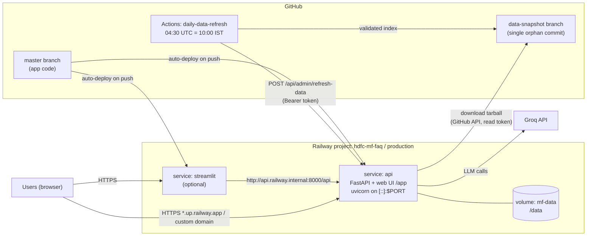

# Deployment Plan: Mutual Fund FAQ Assistant on Railway

> **Project:** RAG-based Facts-Only Mutual Fund FAQ Assistant (HDFC AMC)
> **Target platform:** [Railway](https://railway.com)
> **Reference Docs:** [implementation-plan.md](./implementation-plan.md) · [architecture.md](./architecture.md) · [edge-cases.md](./edge-cases.md)
> **Version:** 1.0
> **Created:** 2026-11-21
> **Status:** Plan — not yet executed. Code prerequisites in **Phase D1** are not implemented.

---

## 1. Summary

The application is deployed to Railway as **one required service (`api`) and one optional service (`streamlit`)**. The daily data refresh **stays on GitHub Actions** (Phase 7), because it needs a headless browser and must not compete with the API for memory. The refreshed index reaches Railway via the `data-snapshot` branch.

| Component | Where it runs | Why |
| :--- | :--- | :--- |
| FastAPI backend **+ web UI** (`/app`) | Railway service `api` | One service serves both the API and the static Stitch UI (same origin, no CORS). |
| Streamlit UI | Railway service `streamlit` (optional) | Second frontend. It calls the API server-side over Railway's private network. |
| Index + chat history | Railway volume `mf-data` mounted at `/data` on `api` | TF-IDF/BM25 artifacts, `metadata.json` and the SQLite chat DB survive restarts and redeploys. |
| Daily scrape → index build → validation | GitHub Actions `daily-data-refresh.yml` (10:00 IST) | Already built and tested (Phase 7). Chrome is preinstalled on the runners. |
| Index hand-off | Orphan branch `data-snapshot` → pulled by `api` | The API downloads the snapshot at startup and when the workflow calls a protected refresh endpoint. It hot-reloads with no restart (Phase 7.9). |

> [!IMPORTANT]
> **Do not use `railway.json` / `railway.toml`.** Railway has deprecated Config as Code. New services cannot opt into it, and existing files **stop being read on 2026-12-01 (hard cutoff)**. This plan uses **Infrastructure as Code** (`.railway/railway.ts`, applied with the Railway CLI) together with a few dashboard-only settings.

---

## 2. Target Architecture



**Data flow on a refresh day:**
1. 10:00 IST: GitHub Actions scrapes → normalizes → cleans → chunks → embeds → validates → force-pushes `data-snapshot` (unchanged from Phase 7).
2. A new last step in the workflow calls `POST https://<api-domain>/api/admin/refresh-data` with a shared secret.
3. The `api` service downloads the `data-snapshot` tarball. It swaps `/data/vectorstore` atomically and writes `/data/metadata.json` last.
4. The retriever sees the new `generated_at` within `INDEX_RELOAD_CHECK_SECONDS` and reloads. The footer shows the new "Last updated from sources" date. No redeploy, no downtime.

**Why not a Railway cron service for the refresh?** A Railway volume attaches to **one** service only. A separate cron service could not write the API's index. It would also need Chrome and about 1 GB of memory. GitHub Actions already does this job and gates it with the Phase 6 tests.

---

## 3. Phasing Summary

| Phase | Name | Owner | Est. | Depends on |
| :---: | :--- | :--- | :---: | :--- |
| **D0** | Repository & accounts | You | 0.5 h | — |
| **D1** | Code changes for Railway | Dev | 0.5–1 day | D0 |
| **D2** | Railway project as code (`.railway/railway.ts`) | Dev | 2 h | D1 |
| **D3** | First deploy & data bootstrap | Dev | 1 h | D2 |
| **D4** | Connect the daily refresh to Railway | Dev | 1 h | D3 |
| **D5** | Verification (smoke, hot reload, UI, failure paths) | Dev + You | 2 h | D4 |
| **D6** | Operations: monitoring, rollback, cost, security | Dev | 1 h | D5 |

---

## Phase D0 — Repository & Accounts

| # | Task | Details |
| :---: | :--- | :--- |
| D0.1 | **Create the GitHub repository and push** | The repo currently has **no remote**. Create `<owner>/<repo>` on GitHub, `git remote add origin …`, and push `master` and `worktree-phase7-daily-refresh`. |
| D0.2 | **Merge Phase 7 into `master`** | The main checkout still holds the Phase 5/6 changes *uncommitted*. They are identical to the branch's first commit. Run `git stash push -m pre-phase7` → `git merge worktree-phase7-daily-refresh` → verify → drop the stash. Railway and the scheduled workflow both use `master`. |
| D0.3 | **Decide repository visibility** | **Public:** the API can download `data-snapshot` without a token. **Private:** create a fine-grained PAT with *Contents: Read-only* on this repo only, stored as the Railway variable `SNAPSHOT_TOKEN`. |
| D0.4 | **Railway account & plan** | **Hobby** ($5/month, includes $5 of usage) is enough. See §6 for the estimate. Install the CLI and run `railway login`. |
| D0.5 | **Secrets inventory** | `GROQ_API_KEY` (Groq console), `REFRESH_TOKEN` (generate 32+ random bytes, e.g. `python -c "import secrets;print(secrets.token_urlsafe(32))"`), `SNAPSHOT_TOKEN` (private repo only), `RAILWAY_TOKEN` (project token, only if IaC is applied from CI). |
| D0.6 | **First data snapshot exists** | Run the workflow once on GitHub (`gh workflow run daily-data-refresh.yml`) so `data-snapshot` exists before the first deploy (Phase 7.12). Without it, the API starts with an empty index and answers with the fallback text. |

---

## Phase D1 — Code Changes Required for Railway

These are **not implemented yet**. Each one closes a gap between the local or self-hosted setup that Phase 7 targets and a Railway container.

| # | Gap on Railway | Change | Files |
| :---: | :--- | :--- | :--- |
| D1.1 | Snapshot paths are hard-coded relative to the repo (`data/vectorstore`, `data/metadata.json` in `snapshot.LIVE_*`). On Railway the persistent data lives on the volume at `/data`. | Derive the `LIVE_*` paths from `settings.vectorstore_path`, `settings.chroma_db_path` and `settings.data_metadata_path`, so `sync_data.py`, `publish_snapshot.py` and the retriever all agree when `VECTORSTORE_PATH=/data/vectorstore` etc. The temp dir for swaps must be created **on the same volume** (`/data/.sync-*`) so renames stay atomic. | `app/ingestion/snapshot.py`, `scripts/sync_data.py`, `scripts/publish_snapshot.py` |
| D1.2 | The deployed container has **no `.git` directory**, so `sync_data.py`'s `git fetch` cannot work. | Add `sync_data.py --from-github <owner/repo>`. It downloads `GET https://api.github.com/repos/<owner>/<repo>/tarball/data-snapshot` (with `Authorization: Bearer $SNAPSHOT_TOKEN` if set), extracts with the existing `_safe_extract`, then runs the existing `install()`. Keep `--from-dir` / git mode for local hosts. | `scripts/sync_data.py` (+ test with a fake tarball) |
| D1.3 | `scripts/run_server.py` starts uvicorn with **`reload=True`** (a dev file watcher) and binds `0.0.0.0` instead of Railway's `$PORT` on `::`. | New production launcher `scripts/railway_start.py`. (1) Run a best-effort startup sync (`--from-github`, never fatal: on failure, serve what is already on the volume). (2) `uvicorn.run("app.main:app", host="::", port=int(os.environ["PORT"]), reload=False, proxy_headers=True, forwarded_allow_ips="*")`. Using a Python launcher avoids relying on shell expansion of `$PORT` in the start command. | `scripts/railway_start.py` (new) |
| D1.4 | No way for the GitHub workflow to tell the running API that a new snapshot exists. Volumes are single-service, so it must happen inside `api`. | `POST /api/admin/refresh-data`. It requires `Authorization: Bearer $REFRESH_TOKEN` and compares with `hmac.compare_digest`; without the env var the endpoint is disabled (404). It runs the D1.2 sync in a background thread under a lock and returns **202** with the current and incoming `generated_at`. The existing hot reload then picks up the new `metadata.json`. Add `GET /api/admin/data-status` (same auth): `generated_at`, `scrape_date`, `run_id`, chunk count, last sync result. | `app/api/routes.py` (or `app/api/admin.py`), `tests/test_api.py` |
| D1.5 | Optional safety net if the workflow's refresh call is missed (for example Railway was briefly down). | Background poll every `SNAPSHOT_POLL_HOURS` (default 6, `0` = off). It runs the same sync if the remote `metadata.json` `generated_at` differs. The GitHub contents API for one file is cheap. | `app/main.py` (lifespan task) |
| D1.6 | `scraper.py` imports **Selenium at module level**, and the runtime imports `chunker → scraper`. The API image therefore needs Selenium even though it never scrapes. | Move `from selenium import webdriver` inside `_create_driver()`. Split dependencies: `requirements.txt` (runtime: FastAPI, uvicorn, groq, scikit-learn, rank-bm25, numpy, scipy, bs4, pydantic(-settings), python-dotenv, requests, streamlit) and `requirements-ingest.txt` (`-r requirements.txt` + selenium, webdriver-manager, chromadb, pytest, httpx). The workflow installs `requirements-ingest.txt`. This makes the Railway image smaller and uses less memory (no onnxruntime/chromadb). | `app/ingestion/scraper.py`, `requirements*.txt`, `.github/workflows/daily-data-refresh.yml` |
| D1.7 | **Pickle compatibility.** The index is built on GitHub (Python 3.11) and loaded on Railway as joblib pickles of scikit-learn / rank-bm25 objects. Unpinned `>=` versions can drift apart, and then the hot reload rejects the snapshot. Phase 7 keeps serving the old index, so the data just stops updating. | Pin exact versions for `scikit-learn`, `numpy`, `scipy`, `rank-bm25`, `joblib` (today: scikit-learn 1.9.1, rank-bm25 0.2.2, joblib 1.6.0) in **both** requirement files. Run Railway on **Python 3.11** (`RAILPACK_PYTHON_VERSION=3.11`) to match CI. Record `sklearn.__version__` in `metadata.json` and log a warning on mismatch. | `requirements*.txt`, `scripts/ingest.py`, `app/core/retriever.py` |
| D1.8 | `/api/chat` is public and every call spends Groq quota. | Add a simple per-IP rate limit (e.g. 20 req/min, in-memory token bucket keyed on the `X-Forwarded-For` first hop) and a max request body size. Return 429 with the existing refusal styling. | `app/api/routes.py` (or middleware) |
| D1.9 | The health check doesn't say whether the index is loaded. | Extend `/api/health` with `index_loaded`, `snapshot_generated_at`, `scrape_date`. Keep it **HTTP 200 even when the index is missing**, so a first deploy before any snapshot still goes live and can be refreshed. | `app/api/routes.py` |
| D1.10 | Tests for the above. | Fake-tarball sync test, refresh endpoint auth (401/404/202), rate limit, launcher arg parsing, Selenium-free import of `app.main` (`python -c "import app.main"` with Selenium uninstalled). | `tests/` |

> [!NOTE]
> **Not needed:** CORS changes. The web UI calls `/api` on its own origin, and Streamlit calls the API **server-side**, so no browser makes cross-origin calls. ChromaDB on Railway is also not needed: run with `VECTOR_DB_PROVIDER=local` (TF-IDF/BM25), the retrieval path the Phase 6 gate validates.

---

## Phase D2 — Railway Project as Code

### D2.1 Initialise

```bash
npm install -g @railway/cli        # or: scoop/brew; see Railway CLI docs
railway login
railway init                        # create project "hdfc-mf-faq" (or `railway link` to an existing one)
railway config init                 # creates .railway/README.md and .railway/railway.ts
npm install --save-dev railway      # TypeScript types for railway/iac
```

### D2.2 `.railway/railway.ts` (proposed)

```ts
import { defineRailway, project, service, volume, github, preserve } from "railway/iac";

export default defineRailway(() => {
  // Persistent data: index (/data/vectorstore), snapshot metadata, SQLite chat history.
  const data = volume("mf-data", { sizeMB: 1024 });

  const api = service("api", {
    source: github("<owner>/<repo>", { branch: "master" }),
    start: "python scripts/railway_start.py",       // D1.3: sync, then uvicorn on [::]:$PORT
    healthcheck: "/api/health",
    healthcheckTimeout: 120,                         // first boot downloads the snapshot
    volumeMounts: { "/data": data },
    env: {
      RAILPACK_PYTHON_VERSION: "3.11",               // match the GitHub Actions build (D1.7)
      PORT: "8000",                                  // fixed so streamlit can reference it
      LLM_PROVIDER: "groq",
      GROQ_MODEL: "openai/gpt-oss-120b",
      LLM_MODEL: "openai/gpt-oss-120b",
      VECTOR_DB_PROVIDER: "local",
      VECTORSTORE_PATH: "/data/vectorstore",
      CHROMA_DB_PATH: "/data/chroma",
      DATA_METADATA_PATH: "/data/metadata.json",
      CHAT_DB_PATH: "/data/chat.db",
      INDEX_RELOAD_CHECK_SECONDS: "60",
      SNAPSHOT_REPO: "<owner>/<repo>",
      SNAPSHOT_BRANCH: "data-snapshot",
      SNAPSHOT_POLL_HOURS: "6",
      TZ: "Asia/Kolkata",
      // Secrets: set once in the dashboard / `railway variables` as sealed values, never in git.
      GROQ_API_KEY: preserve(),
      REFRESH_TOKEN: preserve(),
      SNAPSHOT_TOKEN: preserve(),                    // only needed for a private repo
    },
  });

  // Optional second frontend. Remove this block (and from resources) if the /app web UI is enough.
  const streamlit = service("streamlit", {
    source: github("<owner>/<repo>", { branch: "master" }),
    start: "streamlit run frontend/streamlit_app.py --server.port $PORT --server.address 0.0.0.0 --server.headless true",
    env: {
      RAILPACK_PYTHON_VERSION: "3.11",
      API_URL: preserve(),                           // set in dashboard: http://${{api.RAILWAY_PRIVATE_DOMAIN}}:8000/api
    },
  });

  return project("hdfc-mf-faq", { resources: [api, streamlit, data] });
});
```

> [!WARNING]
> Verify these points against `railway config plan` output before applying. They are not fully covered by the Railway IaC reference:
> - whether a start command expands `$PORT` (the `api` launcher avoids the question; the Streamlit start line relies on it — if not expanded, wrap it in a launcher too);
> - composing a reference variable with a literal port in IaC. This is why `API_URL` is set in the dashboard with Railway's reference syntax `http://${{api.RAILWAY_PRIVATE_DOMAIN}}:8000/api`;
> - the units of `healthcheckTimeout`.

### D2.3 Dashboard-only settings (not expressible in the IaC file today)

| Setting | Service | Value |
| :--- | :--- | :--- |
| Generate Railway domain | `api` (and `streamlit` if kept) | Settings → Networking → *Generate Domain* (generated domains are not part of `railway.ts`). |
| Custom domain (optional) | `api` | Add in IaC as `domains: ["faq.example.com"]` and create the CNAME Railway shows. TLS is automatic. |
| Restart policy | both | *On failure*, max 10 retries. |
| Watch paths | both | Ignore `Docs/**`, `tests/**`, `.github/**` so doc-only pushes do not redeploy. |
| Deploy trigger branch | both | `master` only. **Never `data-snapshot`**: it is force-pushed daily, and data must not trigger redeploys. |
| Wait for CI | both | Enable once a CI test workflow exists (see pending item P7), so a red build never deploys. |
| Sealed variables | `api` | `GROQ_API_KEY`, `REFRESH_TOKEN`, `SNAPSHOT_TOKEN`: set them sealed (value hidden after save). |

### D2.4 Apply

```bash
railway config plan            # review: 2 services, 1 volume, variables (secrets redacted)
railway config apply           # interactive confirmation
railway variables --service api --set "GROQ_API_KEY=…"      # repeat for REFRESH_TOKEN, SNAPSHOT_TOKEN
```

Later, the `railwayapp/config@v1` GitHub Action can plan IaC changes on PRs that touch `.railway/**` and apply them on merge, using a project-scoped `RAILWAY_TOKEN`. This is optional; manual `plan`/`apply` is fine for a two-service project.

---

## Phase D3 — First Deploy & Data Bootstrap

| # | Step | Expected result |
| :---: | :--- | :--- |
| D3.1 | Push `master` (after D1 is merged); Railway builds both services with Railpack (Python 3.11, `pip install -r requirements.txt`). | Build log shows Python 3.11 and no Selenium/chromadb wheels for `api`. |
| D3.2 | `railway_start.py` runs the startup sync: it downloads `data-snapshot` and installs `/data/vectorstore` + `/data/metadata.json`. | Log: `Installed snapshot <generated_at> — scrape date <date>, … chunks`. |
| D3.3 | Healthcheck `/api/health` returns 200 → traffic switches to the new deployment. | Dashboard shows *Active*. Note: a service with a volume always has a **few seconds of downtime per redeploy**, because Railway never runs two deployments on one volume. |
| D3.4 | If `data-snapshot` doesn't exist yet (D0.6 skipped): the API starts with no index, `index_loaded=false`, and answers with the fallback text. Run the workflow, then D4.2. | Recovers without a redeploy. |

---

## Phase D4 — Connect the Daily Refresh to Railway

| # | Task | Details |
| :---: | :--- | :--- |
| D4.1 | **GitHub secrets** | Repo → Settings → Secrets → Actions: `RAILWAY_REFRESH_URL` = `https://<api-domain>/api/admin/refresh-data`, `RAILWAY_REFRESH_TOKEN` = same value as Railway's `REFRESH_TOKEN`. |
| D4.2 | **Workflow step** (after *Promote staging and publish snapshot*) | Shown below. It runs only after a successful publish, and a failure here **fails the run**, so the existing `data-refresh-failure` issue alert fires. The snapshot itself is already safe on `data-snapshot`, and the 6-hourly poll (D1.5) catches up. |
| D4.3 | **Keep schedules in step** | The refresh runs at 10:00 IST. With the push trigger, Railway serves new data within about a minute of publish, so no separate schedule on the app side is needed. |

```yaml
# jobs.refresh.env — add (a step's `if:` cannot see that step's own `env:`, and `secrets` is not allowed in `if:`)
      RAILWAY_REFRESH_URL: ${{ secrets.RAILWAY_REFRESH_URL }}

# new step, after "Promote staging and publish snapshot"
      - name: Tell Railway to load the new snapshot
        id: notify
        if: success() && env.RAILWAY_REFRESH_URL != ''   # skipped until the secret exists
        env:
          RAILWAY_REFRESH_TOKEN: ${{ secrets.RAILWAY_REFRESH_TOKEN }}
        run: |
          curl --fail-with-body --retry 3 --retry-delay 20 --max-time 60 \
               -X POST "$RAILWAY_REFRESH_URL" \
               -H "Authorization: Bearer $RAILWAY_REFRESH_TOKEN"
```

Also add `("notify", "Notify Railway to load the snapshot")` to `STAGES` in `scripts/report_failure.py`, so the alert names the stage.

---

## Phase D5 — Verification Checklist

Run against the Railway URL (`$BASE=https://<api-domain>`).

| # | Check | How | Pass criteria |
| :---: | :--- | :--- | :--- |
| V1 | Health | `curl $BASE/api/health` | 200; `index_loaded: true`; `scrape_date` = latest refresh date |
| V2 | Factual answer | `POST $BASE/api/chat {"query":"What is the NAV of HDFC Mid Cap Fund?"}` | Correct value; exactly one Groww citation; footer date = `scrape_date`; NAV "as of" within 4 days of it |
| V3 | Refusals | advisory ("Should I invest…"), comparative ("Which is better…"), PII ("My PAN is ABCDE1234F") | `is_refusal: true`, categories ADVISORY / COMPARATIVE / PII_DETECTED |
| V4 | Web UI | Open `$BASE/app` in Edge (desktop + phone width) | Status *Online*, answer card with source + "Last updated" footer, no horizontal scroll |
| V5 | Streamlit (if deployed) | Open the streamlit domain | Same answers; proves private networking to `api` |
| V6 | Persistence | Create a chat thread → redeploy `api` → reload | Thread still listed (SQLite on `/data`) |
| V7 | Hot refresh | `gh workflow run daily-data-refresh.yml` → watch the `api` logs | `Installed snapshot …` then `Reloaded vector index: … -> …` with no redeploy; footer date updates |
| V8 | Refresh auth | `POST /api/admin/refresh-data` without / with a wrong token | 401; endpoint returns 404 when `REFRESH_TOKEN` is unset |
| V9 | Bad snapshot is rejected | Point `SNAPSHOT_BRANCH` at a branch holding a truncated `corpus.json` → refresh | Log: `failed to load … still serving <previous>`; answers keep working |
| V10 | Failure alerting | Run the workflow on a test branch with a bad URL in `data/urls.json` | Gate fails, an issue labelled `data-refresh-failure` opens, Railway keeps serving the previous snapshot; the next good run closes the issue |
| V11 | Rate limit | 30 rapid `/api/chat` calls from one IP | 429 after the limit; normal again after the window |

---

## Phase D6 — Operations

### Monitoring & logs
- Railway *Observability* for CPU/RAM/egress per service. Hobby keeps **7 days** of logs.
- Daily: the GitHub Actions job summary (stage timings, core-fact diff, validation warnings) and the `data-refresh-failure` issue.
- Optional: an uptime monitor on `$BASE/api/health` that alerts when `scrape_date` is more than 2 days old.

### Rollback
| What broke | Rollback |
| :--- | :--- |
| App code | Railway → Deployments → *Redeploy* the previous successful deployment (or `git revert` + push). |
| Data (bad facts that passed the gate) | `data-snapshot` holds **one** commit, so there's no git history to roll back to. Download the previous run's `data-snapshot-<run_id>` artifact (14-day retention). Install it with `railway ssh --service api` + `python scripts/sync_data.py --from-dir <dir>`, or re-run the workflow once the source is correct. Consider keeping `/data/vectorstore.prev` on each sync (small change in D1.2). |
| Railway outage | No data loss: the GitHub artifact and `data-snapshot` hold the index; chat history is on the volume. |

### Cost estimate (Hobby; rates from Railway pricing: RAM ≈ $10/GB-month, vCPU ≈ $20/vCPU-month, volume ≈ $0.15/GB-month, egress $0.05/GB)

| Item | Assumption | ≈ $/month |
| :--- | :--- | :---: |
| `api` RAM | ~0.4–0.6 GB resident (FastAPI + scikit-learn + index; no chromadb after D1.6) | 4–6 |
| `api` CPU | mostly idle; bursts during requests and reloads | 1–2 |
| `streamlit` RAM + CPU | ~0.25–0.35 GB | 3–4 |
| Volume | < 100 MB used (billed on usage) | < 0.05 |
| Egress | low traffic | < 1 |
| **Total** | Hobby includes $5 of usage | **≈ $8–13** (≈ $3–8 above the plan fee); **≈ $5–8 without Streamlit** |

These are estimates. Check the real figures in Railway → Usage after a week, and set a usage alert or limit.

### Security
- Secrets only in Railway sealed variables and GitHub Actions secrets. `.env` stays git-ignored (verified: no secrets in the history).
- `REFRESH_TOKEN` is compared in constant time. The refresh endpoint is disabled when the token is unset. Rotate the token every quarter, in both Railway and GitHub.
- `SNAPSHOT_TOKEN`: fine-grained, read-only, single repo, with an expiry date. Put a reminder in the calendar.
- Rate limit `/api/chat` (D1.8). The Groq key is the main cost and abuse risk.
- The facts-only safeguards (classifier, PII guard, refusal templates) are unchanged by deployment. Verify them with V3.

---

## 4. Environment Variables Reference

| Variable | `api` | `streamlit` | Value / source | Secret |
| :--- | :---: | :---: | :--- | :---: |
| `GROQ_API_KEY` | ✅ | | Groq console | 🔒 |
| `LLM_PROVIDER` / `GROQ_MODEL` / `LLM_MODEL` | ✅ | | `groq` / `openai/gpt-oss-120b` | |
| `VECTOR_DB_PROVIDER` | ✅ | | `local` | |
| `VECTORSTORE_PATH` | ✅ | | `/data/vectorstore` | |
| `CHROMA_DB_PATH` | ✅ | | `/data/chroma` (unused with `local`) | |
| `DATA_METADATA_PATH` | ✅ | | `/data/metadata.json` | |
| `CHAT_DB_PATH` | ✅ | | `/data/chat.db` | |
| `INDEX_RELOAD_CHECK_SECONDS` | ✅ | | `60` | |
| `SNAPSHOT_REPO` / `SNAPSHOT_BRANCH` | ✅ | | `<owner>/<repo>` / `data-snapshot` | |
| `SNAPSHOT_TOKEN` | ✅ | | read-only PAT (private repo only) | 🔒 |
| `SNAPSHOT_POLL_HOURS` | ✅ | | `6` (`0` = off) | |
| `REFRESH_TOKEN` | ✅ | | random 32+ bytes; same as GitHub `RAILWAY_REFRESH_TOKEN` | 🔒 |
| `PORT` | ✅ | (Railway-provided) | `8000` on `api` (fixed for the private URL) | |
| `RAILPACK_PYTHON_VERSION` | ✅ | ✅ | `3.11` | |
| `TZ` | ✅ | | `Asia/Kolkata` | |
| `API_URL` | | ✅ | `http://${{api.RAILWAY_PRIVATE_DOMAIN}}:8000/api` | |

GitHub Actions secrets: `RAILWAY_REFRESH_URL`, `RAILWAY_REFRESH_TOKEN` (and `RAILWAY_TOKEN` only if IaC is applied from CI). The refresh workflow itself still needs **no** LLM key.

---

## 5. Risks & Mitigations

| # | Risk | Impact | Likelihood | Mitigation |
| :---: | :--- | :---: | :---: | :--- |
| DR1 | Groww blocks GitHub runner IPs (Phase 7 R7) | High | Medium | The gate keeps the last snapshot live and an issue opens. Fallback: run the workflow on a self-hosted runner, or run `ingest.py` locally and publish. Railway is unaffected either way. |
| DR2 | scikit-learn version drift breaks pickle loading | Medium | Medium (unpinned today) | D1.7 pins versions and runs Python 3.11 on both sides; the retriever keeps the old index on load failure. |
| DR3 | Redeploy downtime on a volume-backed service | Low | Certain (by design) | A few seconds per deploy. Ship code outside 10:00–10:15 IST, and data refreshes never redeploy. |
| DR4 | Config-as-code deprecation | High | Certain | Already avoided: IaC + dashboard settings only; no `railway.json`. |
| DR5 | Groq quota exhaustion / abuse | Medium | Medium | Rate limit (D1.8), Groq usage alerts. The fallback text is returned on LLM errors (existing behavior). |
| DR6 | Refresh call missed (Railway down at 10:00) | Low | Low | 6-hourly poll (D1.5) plus startup sync on every deploy. |
| DR7 | Volume full | Low | Very low | Index is about 3 MB and the chat DB grows slowly; Hobby allows up to 5 GB. Alert at 80%. |
| DR8 | Private network issue between `streamlit` and `api` | Low | Low | `api` binds `::` (dual-stack), as Railway recommends for old and new environments; the web UI at `/app` doesn't depend on it. |

---

## 6. Pending Decisions & Open Items

- **P1 — Repo visibility** (public = no `SNAPSHOT_TOKEN`; private = PAT). *Decision needed.*
- **P2 — Keep Streamlit?** `/app` already covers the UI. Dropping `streamlit` halves cost and removes the private-network dependency. *Decision needed.*
- **P3 — Custom domain?** If yes, add it to IaC `domains` and create the CNAME. *Decision needed.*
- **P4 — Implement Phase D1** (code changes). Nothing in this plan works on Railway without D1.1–D1.4 and D1.6–D1.7.
- **P5 — Run Phase 7.12 on GitHub first** (first `workflow_dispatch`, 3 scheduled days, one forced failure) so the data pipeline is proven before Railway depends on it.
- **P6 — Phase 8 documentation** (README deployment section and `architecture.md` update) once deployed.
- **P7 — Add a CI test workflow** (`pytest` on push/PR) so Railway's *Wait for CI* can block red builds; today only the daily refresh workflow exists.
- **P8 — Known answer gap (pre-existing):** "riskometer level of HDFC Small Cap" returns the fallback. It isn't a deployment blocker, but users will hit it.
- **P9 — Verify the IaC details marked ⚠️ in D2.2** (`$PORT` expansion, reference composition, `healthcheckTimeout` units) with `railway config plan` on first apply.

---

## 7. Sources

- Railway — Infrastructure as Code: <https://docs.railway.com/infrastructure-as-code> and reference: <https://docs.railway.com/infrastructure-as-code/reference> (Config as Code deprecation, cutoff 2026-12-01)
- Railway — Config as Code (deprecated): <https://docs.railway.com/config-as-code>
- Railway — Volumes reference (one volume per service, no replicas, redeploy downtime, size limits): <https://docs.railway.com/volumes/reference>
- Railway — Private networking (bind `::`, `*.railway.internal`): <https://docs.railway.com/private-networking>
- Railway — Pricing plans: <https://docs.railway.com/pricing/plans>
- Railpack — Python (version selection, `RAILPACK_PYTHON_VERSION`): <https://railpack.com/languages/python/>
