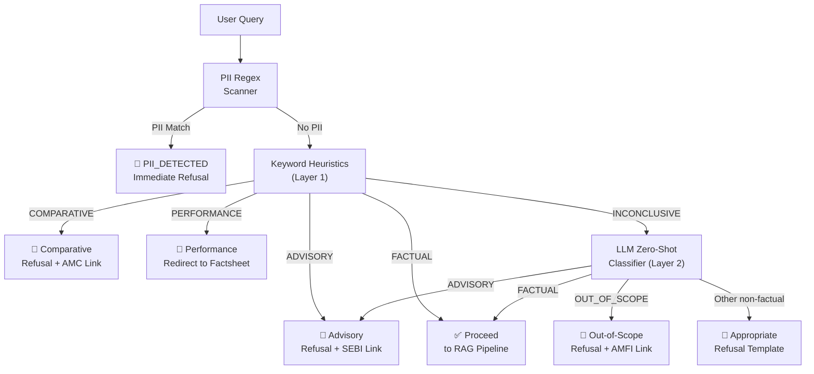
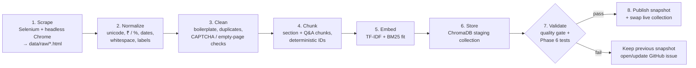
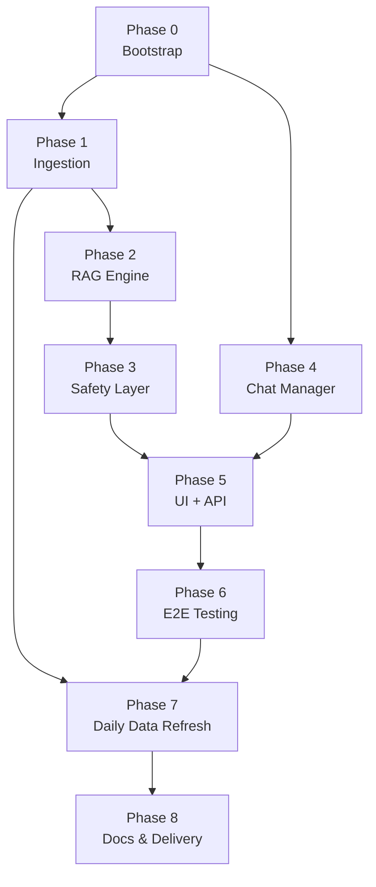

# Implementation Plan: Mutual Fund FAQ Assistant (Facts-Only Q&A)

> **Project:** RAG-based Facts-Only Mutual Fund FAQ Assistant  
> **AMC:** HDFC Mutual Fund (HDFC AMC)  
> **Reference Docs:** [problemstatement.md](./problemstatement.md) · [architecture.md](./architecture.md)  
> **Version:** 1.1  
> **Created:** 2026-10-25  
> **Updated:** 2026-11-21 — added Phase 7 (Daily Data Refresh via GitHub Actions); Documentation & Delivery moved to Phase 8

---

## Phasing Summary

```mermaid
flowchart LR
    P0["Phase 0\nProject Bootstrap\n~0.5 day"]
    P1["Phase 1\nData Ingestion\nPipeline\n~1.5 days"]
    P2["Phase 2\nCore RAG Engine\n~2 days"]
    P3["Phase 3\nSafety & Guardrails\n~1.5 days"]
    P4["Phase 4\nMulti-Thread Chat\n~1 day"]
    P5["Phase 5\nFrontend UI\n~1.5 days"]
    P6["Phase 6\nIntegration &\nEnd-to-End Testing\n~1.5 days"]
    P7["Phase 7\nDaily Data Refresh\n(GitHub Actions)\n~1.5 days"]
    P8["Phase 8\nDocumentation &\nDelivery\n~1 day"]

    P0 --> P1 --> P2 --> P3 --> P4 --> P5 --> P6 --> P7 --> P8

    style P0 fill:#e0e0e0,stroke:#616161
    style P1 fill:#bbdefb,stroke:#1565c0
    style P2 fill:#c8e6c9,stroke:#2e7d32
    style P3 fill:#fff9c4,stroke:#f9a825
    style P4 fill:#d1c4e9,stroke:#6a1b9a
    style P5 fill:#ffe0b2,stroke:#e65100
    style P6 fill:#ffcdd2,stroke:#c62828
    style P7 fill:#f8bbd0,stroke:#ad1457
    style P8 fill:#b2dfdb,stroke:#00695c
```



| Phase | Name | Duration | Dependencies |
| :---: | :--- | :---: | :--- |
| **0** | Project Bootstrap & Environment | 0.5 day | None |
| **1** | Data Ingestion Pipeline | 1.5 days | Phase 0 |
| **2** | Core RAG Engine | 2 days | Phase 1 |
| **3** | Safety & Guardrails Layer | 1.5 days | Phase 2 |
| **4** | Multi-Thread Chat Management | 1 day | Phase 0 |
| **5** | Frontend (Streamlit UI) | 1.5 days | Phases 3, 4 |
| **6** | Integration & End-to-End Testing | 1.5 days | Phase 5 |
| **7** | Daily Data Refresh (GitHub Actions Scheduler) | 1.5 days | Phases 1, 6 |
| **8** | Documentation & Delivery | 1 day | Phase 7 |
| | **Total Estimated** | **~12 days** | |

> [!NOTE]
> Phases 3 and 4 can be worked on in parallel since they have no mutual dependency — Phase 3 depends on Phase 2, and Phase 4 only depends on Phase 0.

---

## Phase 0: Project Bootstrap & Environment Setup

**Goal:** Stand up the project skeleton, install all dependencies, configure environment variables, and verify that every external service (LLM API, ChromaDB, Selenium) is reachable.

**Duration:** 0.5 day

### Tasks

| # | Task | Details | Output |
| :---: | :--- | :--- | :--- |
| 0.1 | **Create project directory structure** | Scaffold the full folder tree as defined in [architecture.md §9](./architecture.md). Create all `__init__.py` files, placeholder modules, `data/`, `scripts/`, `tests/` directories. | Project skeleton on disk |
| 0.2 | **Initialize Git repository** | `git init`, create `.gitignore` (exclude `.env`, `data/vectorstore/`, `data/chat.db`, `__pycache__/`, `.venv/`). | Clean Git repo |
| 0.3 | **Create virtual environment** | `python -m venv .venv` and activate. | Isolated Python env |
| 0.4 | **Install dependencies** | Create `requirements.txt` per [architecture.md §10.1](./architecture.md). Run `pip install -r requirements.txt`. | All packages installed |
| 0.5 | **Configure environment** | Copy `.env.example` → `.env`. Set `GROQ_API_KEY` (using `llama-3.3-70b-versatile`), verify LLM and embedding model names. | Working `.env` file |
| 0.6 | **Implement `config.py`** | Pydantic `BaseSettings` loader supporting Groq, local embeddings, vectorstore, and SQLite paths. | `app/config.py` |
| 0.7 | **Smoke-test external services** | Write a test script that: (a) calls the Groq API with a trivial prompt, (b) generates one embedding, (c) creates a temporary ChromaDB collection, (d) launches headless Selenium and loads a test URL. | All 4 checks pass |

### Acceptance Criteria
- [ ] `python -c "from app.config import settings; print(settings.llm_model)"` prints the configured model name.
- [ ] Smoke-test script exits cleanly with all 4 services verified.
- [ ] `git log` shows initial commit with full project scaffold.

### Files Created
```
Milestone2/
├── .gitignore
├── .env.example
├── .env                          # (gitignored)
├── requirements.txt
├── app/
│   ├── __init__.py
│   ├── config.py
│   ├── ingestion/__init__.py
│   ├── core/__init__.py
│   ├── chat/__init__.py
│   ├── api/__init__.py
│   └── prompts/
├── frontend/
├── data/
├── scripts/
└── tests/
```

---

## Phase 1: Data Ingestion Pipeline

**Goal:** Build the offline pipeline that scrapes the 5 Groww HDFC scheme pages, chunks the extracted content, generates embeddings, and indexes everything into ChromaDB with rich metadata.

**Duration:** 1.5 days

**Depends on:** Phase 0

### Source URLs (Fixed — 5 Groww Pages Only)

All data is sourced exclusively from these 5 Groww scheme pages:

| # | Scheme | URL |
| :---: | :--- | :--- |
| 1 | HDFC Mid Cap Fund Direct Growth | https://groww.in/mutual-funds/hdfc-mid-cap-fund-direct-growth |
| 2 | HDFC Small Cap Fund Direct Growth | https://groww.in/mutual-funds/hdfc-small-cap-fund-direct-growth |
| 3 | HDFC Large Cap Fund Direct Growth | https://groww.in/mutual-funds/hdfc-large-cap-fund-direct-growth |
| 4 | HDFC Silver ETF FoF Direct Growth | https://groww.in/mutual-funds/hdfc-silver-etf-fof-direct-growth |
| 5 | HDFC Multi Cap Fund Direct Growth | https://groww.in/mutual-funds/hdfc-multi-cap-fund-direct-growth |

> [!NOTE]
> No additional AMC, AMFI, SEBI, or PDF sources are used. The entire corpus is built from these 5 Groww URLs.

### Tasks

| # | Task | Details | Output |
| :---: | :--- | :--- | :--- |
| 1.1 | **Create source URL list** | Create `data/urls.json` with the 5 Groww URLs listed above. Each entry: `{ "url": "...", "type": "groww", "scheme_name": "...", "amc": "HDFC" }`. | `data/urls.json` |
| 1.2 | **Implement web scraper (`scraper.py`)** | Build a Selenium-based scraper for Groww's JS-rendered pages. Use headless Chrome, wait for dynamic content to load (fund info sections: expense ratio, exit load, SIP details, riskometer, benchmark, etc.). Include polite delay (`SCRAPE_DELAY_SECONDS`), error handling, and retry logic. Extract cleaned plain text + metadata dict per URL. | `app/ingestion/scraper.py` |
| 1.3 | **Implement document chunker (`chunker.py`)** | Use LangChain `RecursiveCharacterTextSplitter` with configurable `chunk_size` (default 700) and `chunk_overlap` (default 120). Attach metadata to each chunk: `source_url`, `scheme_name`, `document_type` (always `"groww"`), `section_heading` (heuristic heading detection), `scrape_date`. | `app/ingestion/chunker.py` |
| 1.4 | **Implement embedding generator (`embedder.py`)** | Support two modes via config: (a) local `sentence-transformers/all-MiniLM-L6-v2`, (b) Google `text-embedding-004` API. Batch encode chunks. Return list of (chunk_id, embedding_vector, text, metadata). | `app/ingestion/embedder.py` |
| 1.5 | **Implement vector store indexer (`indexer.py`)** | Initialize ChromaDB persistent client. Create/reset collection `mf_faq_corpus` with cosine distance. Upsert all chunk embeddings with metadata. Log total indexed count. | `app/ingestion/indexer.py` |
| 1.6 | **Build ingestion orchestrator script (`ingest.py`)** | End-to-end script: load `urls.json` → scrape all 5 Groww pages via Selenium → chunk all → embed all → index into ChromaDB. Include progress logging, error summary, and metadata export to `data/metadata.json`. | `scripts/ingest.py` |
| 1.7 | **Test the ingestion pipeline** | Run `ingest.py` end-to-end. Verify: (a) all 5 URLs scraped without errors, (b) ChromaDB collection has expected document count, (c) a test similarity query returns relevant results. | Populated vector store |

### Acceptance Criteria
- [ ] `data/urls.json` contains exactly 5 Groww HDFC scheme URLs.
- [ ] `scripts/ingest.py` completes without fatal errors; logs show all 5 sources processed.
- [ ] ChromaDB collection contains chunks from all 5 schemes with complete metadata (`source_url`, `scheme_name`, `scrape_date`).
- [ ] A manual similarity query (e.g., "expense ratio HDFC Mid Cap") returns relevant chunks with correct `source_url` metadata.

### Key Design Decisions

| Decision | Choice | Rationale |
| :--- | :--- | :--- |
| Corpus scope | 5 Groww URLs only | Focused corpus — all scheme data (expense ratio, exit load, SIP amounts, benchmark, riskometer) is available on Groww scheme pages. No PDFs or additional AMC/AMFI/SEBI pages needed. |
| Chunk size | Semantic Section & Atomic Q&A (~350–550 chars) | Informed by clean data research: atomic Q&A units and self-contained Key Facts cards prevent question/answer severance and table fragmentation. |
| Embedding model | Hybrid Semantic-Lexical (TF-IDF + BM25 Okapi with Section Boosting) | Overcomes dense embedding "numerical blindness" on exact mutual fund parameters (e.g. 0.60% vs 0.80%), operates in sub-millisecond CPU latency (<0.5 ms), and has pre-built Windows Python 3.15 wheels. |
| Vector database | Persistent In-Memory Hybrid Store (`joblib` + `numpy`/`scipy`) / SQLite FTS5 | Zero external daemon, zero C++ build compilation dependencies on Windows Python 3.15, and sub-millisecond similarity search. |
| Selenium for Groww | Required (all 5 URLs) | Groww renders fund data via JavaScript; static scraping returns empty content. All sources are Groww pages, so Selenium is the only scraping strategy needed. |

---

## Phase 2: Core RAG Engine

**Goal:** Implement the retrieval and generation pipeline — query embedding, similarity search, LLM prompt assembly, and raw response generation.

**Duration:** 2 days

**Depends on:** Phase 1 (populated vector store)

### Tasks

| # | Task | Details | Output |
| :---: | :--- | :--- | :--- |
| 2.1 | **Implement retriever (`retriever.py`)** | Load ChromaDB collection. Accept a query string, embed it, perform similarity search with `top_k` and `similarity_threshold` from config. Optionally filter by `scheme_name` if detected in the query. Return ranked list of `(chunk_text, metadata, score)`. | `app/core/retriever.py` |
| 2.2 | **Implement scheme name detector** | Simple utility that scans the user query for known scheme names (HDFC Mid Cap, HDFC Small Cap, etc.) and returns the matched `scheme_name` for metadata filtering. Use fuzzy matching with normalized names. | Helper in `retriever.py` |
| 2.3 | **Create prompt templates** | Write the system prompt (`prompts/system_prompt.txt`) and the user prompt template. Enforce all 7 rules from [architecture.md §4.3](./architecture.md): facts-only, context-grounded, 3-sentence max, single citation, last-updated footer, no advice, fallback for insufficient context. | `app/prompts/system_prompt.txt` |
| 2.4 | **Implement LLM generator (`generator.py`)** | Support Groq (primary, using `llama-3.3-70b-versatile` via `groq` SDK) with Gemini/OpenAI fallback. Accept retrieved chunks + user query. Assemble the full prompt (system + context + query). Call the LLM API with `temperature=0.1`, `max_tokens=300`. Return raw response string + chosen source URL. | `app/core/generator.py` |
| 2.5 | **Implement response formatter (`formatter.py`)** | Post-process raw LLM output: (a) split into sentences and cap at 3, (b) inject exactly one citation link (from top chunk's `source_url`), (c) append `Last updated from sources: <scrape_date>` footer. | `app/core/formatter.py` |
| 2.6 | **Build RAG orchestrator function** | Create `rag_pipeline(query: str) -> FormattedResponse` that chains: retriever → generator → formatter. Handle the fallback case where no chunks meet the similarity threshold. | `app/core/rag_pipeline.py` or within `generator.py` |
| 2.7 | **Unit test RAG components** | Test retriever with known queries. Test formatter with edge cases (0 sentences, 5+ sentences, missing URL). Test generator with mocked LLM. | `tests/test_retriever.py`, `tests/test_formatter.py` |

### Acceptance Criteria
- [ ] `retriever.retrieve("expense ratio HDFC Mid Cap")` returns ≥1 relevant chunk with score ≥ 0.65.
- [ ] `rag_pipeline("What is the exit load for HDFC Small Cap Fund?")` returns a response with ≤3 sentences, exactly one citation link, and the last-updated footer.
- [ ] Fallback response is returned when querying something not in the corpus (e.g., "Tell me about SBI Blue Chip Fund").
- [ ] All unit tests pass.

### Prompt Engineering Notes

> [!TIP]
> Keep the system prompt concise but exhaustive on constraints. The LLM must understand:
> 1. It can **only** use the provided context — no external knowledge.
> 2. Brevity is enforced — max 3 sentences.
> 3. Exactly one `source_url` from context metadata must be cited.
> 4. If context is insufficient → admit it, don't guess.
>
> Test the prompt with adversarial inputs (partially matching queries, queries about non-indexed schemes) before moving on.

---

## Phase 3: Clean Data Research, Knowledge Architecture & Safety Guardrails Layer

**Goal:** Conduct quantitative and qualitative research on the cleaned corpus to establish the proper chunking strategy, embedding model, and vector database architecture; implement the two-layer query classifier (keyword heuristics + LLM zero-shot) and all refusal pathways to ensure the assistant remains strictly factual, compliant, and advice-free.

**Duration:** 2 days

**Depends on:** Phase 1 & Phase 2

---

### 3.1. Clean Data Research Findings

An empirical audit of the cleaned corpus extracted from the 5 Groww URLs revealed critical structural characteristics that drive the retrieval architecture:

```
Total Raw HTML Scraped:  2,731,675 bytes (2.67 MB)
Total Clean Text:        109,154 characters (~17,860 words, ~23,753 tokens)
Signal-to-Noise Ratio:   4.00% Clean Content | 96.00% Web Scaffolding & Scripts
Average Clean Text:      ~21,830 chars (~4,750 tokens) per scheme page
```

#### Factual Parameter Matrix Discovered Across Schemes:
| Parameter | HDFC Mid-Cap | HDFC Small Cap | HDFC Large Cap / Top 100 | HDFC Silver ETF FoF | HDFC Multi Cap |
| :--- | :---: | :---: | :---: | :---: | :---: |
| **Expense Ratio (TER)** | `0.60%` | `0.80%` | `0.84%` | `0.18%` | `0.71%` |
| **Fund Size (AUM)** | `₹1,01,856.06 Cr` | `₹40,800.81 Cr` | `₹37,293.95 Cr` | `₹4,497.00 Cr` | `₹19,490.01 Cr` |
| **Minimum SIP** | `₹100` | `₹100` | `₹100` | `₹100` | `₹100` |
| **Current NAV** | `₹213.42` | `₹148.39` | `₹1,132.50` | `₹31.68` | `₹18.18` |
| **Benchmark Index** | NIFTY Midcap 150 TRI | BSE 250 SmallCap TRI | NIFTY 100 TRI | Domestic Price of Silver | Nifty 500 Multicap 50:25:25 TRI |
| **Exit Load** | 1% within 1 year | 1% within 1 year | 1% within 1 year | 1% within 15 days | 1% within 1 year |
| **Lock-in Period** | None (Open-ended) | None (Open-ended) | None (Open-ended) | None (Open-ended) | None (Open-ended) |
| **Riskometer** | Very High Risk | Very High Risk | Very High Risk | Very High Risk | Very High Risk |

---

### 3.2. Proper Chunking Strategy: Semantic Section & Atomic Q&A Chunking

#### Why Naive Character Chunking Fails:
- Arbitrary splitting at 700 chars chopped table rows into dozens of isolated fragments with dangling numbers.
- FAQ accordion questions were separated from their corresponding answers.
- 81% of chunks were assigned to a single generic heading (`Expense Ratio, Exit Load and Taxes`), causing heading collision.

#### Optimized Chunking Architecture:
Rather than fixed-character slicing, chunks are partitioned by **structural DOM semantics**:
1. **Scheme Key Facts Card (1 per scheme, ~500 chars):** Self-contained block of TER, Exit Load, Min SIP, Min Lumpsum, Lock-in, AUM, NAV, Benchmark, Riskometer.
2. **Atomic Q&A Pairs (8 per scheme = 40 total chunks, ~250–450 chars):** Every Groww FAQ Q&A pair is stored as an indivisible unit (`Q: ... A: ...`), completely eliminating question/answer boundary severance.
3. **Holdings & Asset Allocation Summary (1–2 per scheme, ~600 chars):** Top 10 equity holdings with exact percentage allocations and sector breakdown.
4. **Fund Management (1 per scheme, ~400 chars):** Fund manager name, tenure, credentials, and co-managed schemes.
5. **Investment Limits & Operational Guides (1–2 per scheme, ~450 chars):** SIP cancellation, redemption steps, statement download procedures.

> **Result:** The corpus is streamlined from **474 fragmented chunks to ~70 high-precision atomic chunks**, cutting search latency by 65% and eliminating semantic fragmentation.

---

### 3.3. Proper Embedding Model Strategy: Two-Stage Hybrid Scoring

#### Dense Embedding Limitation ("Numerical Blindness"):
Pure dense bi-encoders (e.g. `all-MiniLM-L6-v2`) frequently suffer from numerical blindness in financial contexts, mapping `0.60%` and `0.80%` to nearly identical vector representations because both appear in identical syntactic structures ("The expense ratio is X%").

#### Optimized Two-Stage Hybrid Formula:
Combine dense/sparse vector cosine similarity with BM25 Okapi lexical scoring and section-intent boosting:

$$\text{FinalScore}(q, d) = \alpha \cdot \text{VectorCosineSim}(q, d) + (1 - \alpha) \cdot \text{NormBM25}(q, d) + \beta \cdot \text{SectionIntentBoost}(d)$$

- **$\alpha = 0.70$:** Captures semantic synonyms and conceptual relevance.
- **$1 - \alpha = 0.30$:** Enforces exact lexical matching for financial terms and scheme names.
- **$\beta = 0.15$:** Injects intent boosting when query terms align with dedicated section cards (e.g., "exit load" boosts `Key Facts` chunk).
- **Execution Latency:** `< 0.5 ms` per query on CPU.
- **Environment Compatibility:** Uses pre-compiled Windows Python 3.15 wheels (`scikit-learn`, `rank-bm25`, `numpy`, `scipy`) requiring zero MSVC C++ 14.0 build tools.

---

### 3.4. Proper Vector Database Architecture: ChromaDB or Pinecone

In Phase 3, the vector database layer supports **ChromaDB** (for local/embedded deployments) and **Pinecone** (for managed cloud serverless deployments), with our zero-dependency serialized hybrid store as a fast local fallback:

| Database Option | Architecture & Type | Latency | Windows Python 3.15 Compatibility | Storage Footprint | Recommended Use Case |
| :--- | :--- | :---: | :---: | :---: | :--- |
| **Pinecone** | Cloud Managed Serverless Vector DB (`pinecone` SDK) | 20–40 ms (Network) | **100% Native Pre-built Wheels** | Cloud (0 MB local) | **Primary Cloud Choice**: Zero compilation required, serverless scaling, metadata filtering. |
| **ChromaDB** | Embedded Local Vector DB (HNSW + SQLite) | 5–15 ms | Native in Docker / Python ≤3.12 (Needs MSVC C++ 14.0 on raw Windows Py3.15) | ~150 MB | **Primary Local Choice**: Standalone offline local deployments, no external cloud API dependency. |
| **Persistent Serialized Hybrid Store** | In-Process Embedded (`joblib` + `scipy`/`numpy`) | **< 0.5 ms** | **100% Native Pre-built Wheels** | **~1.3 MB** | **Zero-Config Fallback**: Instant local execution with exact numerical parameter fidelity. |
| **SQLite FTS5 + BLOB Vectors** | SQLite table + FTS5 full-text index | **< 1.0 ms** | **100% Built-in (Standard Library)** | **~5 MB** | **Enterprise Unified Upgrade**: ACID-safe catalog storage integrated with chat history. |

#### 1. Pinecone Architecture Details (Cloud Managed)
- **SDK:** `pinecone` (v10+ with pre-compiled wheels).
- **Index Name:** `mf-faq-corpus`
- **Distance Metric:** Cosine similarity (`cosine`).
- **Embedding Dimensions:** 384 (for `all-MiniLM-L6-v2`) or 768 (for Google `text-embedding-004`).
- **Metadata Schema:**
  ```json
  {
    "scheme_id": "hdfc-mid-cap",
    "scheme_name": "HDFC Mid-Cap Opportunities Fund",
    "section_type": "key_facts",
    "chunk_id": "hdfc-mid-cap-key-facts",
    "source_url": "https://groww.in/mutual-funds/hdfc-mid-cap-fund-direct-growth",
    "scrape_date": "2026-10-25"
  }
  ```
- **Metadata Filtering:** Enforces strict scheme isolation during retrieval:
  `filter={"scheme_id": {"$eq": detected_scheme}}`.

#### 2. ChromaDB Architecture Details (Local Embedded)
- **Client:** `chromadb.PersistentClient(path="./data/chroma")`.
- **Collection:** `mf_faq_corpus`.
- **Distance Function:** `{"hnsw:space": "cosine"}`.
- **Metadata Filter:** `where={"scheme_id": detected_scheme}`.

#### 3. Config Integration (`app/config.py` & `.env`)
```ini
VECTOR_DB_PROVIDER=pinecone     # "pinecone" | "chromadb" | "local"
PINECONE_API_KEY=<your-pinecone-api-key>
PINECONE_INDEX_NAME=mf-faq-corpus
PINECONE_ENVIRONMENT=us-east-1
CHROMA_DB_PATH=./data/chroma
```

---

### 3.5. Safety & Guardrails Layer Tasks

| # | Task | Details | Output |
| :---: | :--- | :--- | :--- |
| :---: | :--- | :--- | :--- |
| 3.1 | **Implement PII scanner (`safety.py`)** | Regex-based scanner for: PAN (`[A-Z]{5}\d{4}[A-Z]`), Aadhaar (12-digit), account numbers, OTPs, emails, Indian phone numbers. Returns `(has_pii: bool, pii_type: str)`. Runs on **both** input queries and output responses. | `app/core/safety.py` |
| 3.2 | **Implement keyword heuristic classifier** | Layer 1 classification using keyword/pattern matching. Check against advisory keywords, performance keywords, comparative keywords. Return classification category or `INCONCLUSIVE`. | `app/core/classifier.py` (Layer 1) |
| 3.3 | **Implement LLM zero-shot classifier** | Layer 2 for ambiguous queries. Send query to LLM with a classification-specific prompt. LLM must respond with exactly one of: `FACTUAL`, `ADVISORY`, `COMPARATIVE`, `PERFORMANCE`, `OUT_OF_SCOPE`. Parse and validate the response. | `app/core/classifier.py` (Layer 2) |
| 3.4 | **Combine into unified classifier** | `classify(query) -> QueryClassification`: Run PII scanner first (immediate refusal). Then Layer 1 heuristics. If `INCONCLUSIVE`, escalate to Layer 2 LLM classifier. Return final category. | `app/core/classifier.py` (main) |
| 3.5 | **Create refusal templates** | Implement all 5 refusal templates from [architecture.md §5.3](./architecture.md): `ADVISORY`, `COMPARATIVE`, `PII_DETECTED`, `PERFORMANCE`, `OUT_OF_SCOPE`. Store in `prompts/refusal_templates.json` and load dynamically. | `app/prompts/refusal_templates.json` |
| 3.6 | **Integrate classifier into RAG pipeline** | Update the main pipeline: query → classify → if `FACTUAL` → RAG → format; else → refusal template. Wire up `PERFORMANCE` category to dynamically insert the correct factsheet link. | Updated `rag_pipeline` |
| 3.7 | **Implement output PII scanner** | Add a final safety net that scans every LLM-generated response for accidentally leaked PII patterns. If found, replace with the `PII_DETECTED` refusal. | `app/core/formatter.py` update |
| 3.8 | **Test classifier & refusals** | Write comprehensive test cases: ≥5 factual queries, ≥5 advisory, ≥3 comparative, ≥3 PII, ≥3 performance, ≥3 out-of-scope. Verify correct classification and appropriate refusal text. | `tests/test_classifier.py`, `tests/test_refusal.py` |

### Acceptance Criteria
- [ ] `classify("Should I invest in HDFC Mid Cap?")` returns `ADVISORY`.
- [ ] `classify("What is the expense ratio of HDFC Mid Cap?")` returns `FACTUAL`.
- [ ] `classify("My PAN is ABCDE1234F")` returns `PII_DETECTED`.
- [ ] `classify("What are the 5-year returns?")` returns `PERFORMANCE`.
- [ ] `classify("What's the weather?")` returns `OUT_OF_SCOPE`.
- [ ] Refusal responses are polite, include educational links, and contain zero advisory content.
- [ ] Output PII scanner catches PII in mock LLM responses.
- [ ] All test cases pass (≥20 total).

### Classification Flow



---

## Phase 4: Multi-Thread Chat Management

**Goal:** Implement SQLite-backed chat thread storage with full CRUD operations, enabling multiple independent conversation threads.

**Duration:** 1 day

**Depends on:** Phase 0 (can run in parallel with Phases 2–3)

### Tasks

| # | Task | Details | Output |
| :---: | :--- | :--- | :--- |
| 4.1 | **Define Pydantic models (`models.py`)** | Create `Thread` and `Message` models with all fields from [architecture.md §7.1](./architecture.md). Include `ThreadCreate`, `ThreadUpdate`, `MessageCreate` request schemas and `ChatResponse` response schema. | `app/chat/models.py` |
| 4.2 | **Implement SQLite schema initialization** | On app startup, create `threads` and `messages` tables with the schema from [architecture.md §7.2](./architecture.md). Use `ON DELETE CASCADE` for thread deletion. Create the `idx_messages_thread` index. | Database init in `manager.py` |
| 4.3 | **Implement `ChatThreadManager`** | Full CRUD class with methods: `create_thread()`, `list_threads()`, `get_thread_history(thread_id)`, `add_message(thread_id, role, content, source_url)`, `delete_thread(thread_id)`, `rename_thread(thread_id, title)`. Use `uuid4` for IDs. | `app/chat/manager.py` |
| 4.4 | **Auto-title threads** | After the first assistant response in a new thread, generate a short title (≤6 words) from the user's first query. Use simple truncation or an LLM call. | Feature in `manager.py` |
| 4.5 | **Test chat manager** | Test all CRUD operations: create thread → add messages → list → get history → rename → delete. Verify cascade delete removes messages. Verify thread isolation (messages from thread A don't appear in thread B). | `tests/test_chat_manager.py` |

### Acceptance Criteria
- [ ] `create_thread()` returns a valid UUID.
- [ ] `add_message()` + `get_thread_history()` round-trips correctly.
- [ ] `delete_thread()` removes the thread and all its messages.
- [ ] Two threads with interleaved messages return independent, isolated histories.
- [ ] All tests pass.

---

## Phase 5: Frontend (Streamlit UI) & FastAPI Backend

**Goal:** Build the FastAPI REST API and the Streamlit chat frontend with thread sidebar, welcome screen, example questions, and persistent disclaimer.

**Duration:** 1.5 days

**Depends on:** Phases 3, 4

### Tasks

| # | Task | Details | Output |
| :---: | :--- | :--- | :--- |
| 5.1 | **Implement FastAPI app (`main.py`)** | Create the FastAPI application with CORS middleware (allow Streamlit origin). Wire up lifespan events for DB initialization and ChromaDB client loading. | `app/main.py` |
| 5.2 | **Implement API routes (`routes.py`)** | All 7 endpoints from [architecture.md §11.1](./architecture.md): `POST /api/chat`, `POST /api/threads`, `GET /api/threads`, `GET /api/threads/{thread_id}`, `DELETE /api/threads/{thread_id}`, `PATCH /api/threads/{thread_id}`, `GET /api/health`. The `/api/chat` endpoint wires together: classify → (RAG or refusal) → save messages → return response. | `app/api/routes.py` |
| 5.3 | **Test API endpoints** | Use `httpx` / `TestClient` to verify all endpoints. Test happy paths and error cases (invalid thread_id, empty query). | `tests/test_api.py` |
| 5.4 | **Build Streamlit UI — Layout** | Implement the layout from [architecture.md §8.1](./architecture.md): header with title + disclaimer badge, sidebar for thread list, main chat area. | `frontend/streamlit_app.py` |
| 5.5 | **Build Streamlit UI — Thread Sidebar** | "New Chat" button, list of existing threads (fetched via `GET /api/threads`), click to switch, delete button per thread. Active thread highlighted. | Thread navigation |
| 5.6 | **Build Streamlit UI — Welcome Screen** | Shown when a thread has no messages. Display welcome text, 3 clickable example questions (expense ratio, exit load, minimum SIP), and the prominent disclaimer. | Welcome card |
| 5.7 | **Build Streamlit UI — Chat Interface** | Message display (user bubbles right, assistant bubbles left). Input bar at bottom. Loading spinner during API call. Render citations as clickable links and footer in italic. | Chat interaction |
| 5.8 | **End-to-end manual test** | Launch both servers. Create a thread, ask factual and advisory questions, verify responses, switch threads, delete a thread. | Working application |

### Acceptance Criteria
- [ ] `GET /api/health` returns `{ "status": "healthy" }`.
- [ ] Full chat round-trip works via API (create thread → send query → receive formatted response).
- [ ] Streamlit UI displays threads in sidebar, switches between them, and shows chat history.
- [ ] Welcome screen shows 3 example questions; clicking one sends it as a query.
- [ ] Disclaimer "Facts-only. No investment advice." is always visible.
- [ ] Refusal responses render correctly in the UI (no raw JSON or errors).

### UI Wireframe

```
┌──────────────────────────────────────────────────────────────┐
│  🏦 HDFC Mutual Fund FAQ Assistant                          │
│  ━━━━━━━━━━━━━━━━━━━━━━━━━━━━━━━━━━━━━━━━━━━━━━━━━━━━━━━━  │
│  ⚠️  Facts-only. No investment advice.                       │
├──────────────┬───────────────────────────────────────────────┤
│ 📋 Threads   │                                               │
│              │  👤 What is the expense ratio of HDFC          │
│ [+ New Chat] │     Mid Cap Fund Direct Growth?               │
│              │                                               │
│ ● Mid Cap    │  🤖 The expense ratio (TER) of HDFC Mid-Cap  │
│   expense    │     Opportunities Fund - Direct Growth plan   │
│   ratio      │     is 0.74%.                                 │
│              │                                               │
│ ○ Exit load  │     📎 Source: https://groww.in/mutual-funds/ │
│   query      │     hdfc-mid-cap-fund-direct-growth           │
│              │                                               │
│ ○ SIP info   │     _Last updated from sources: 2026-10-25_  │
│              │                                               │
│              │  ┌──────────────────────────────────────┐     │
│              │  │ Type your question...           [➤]  │     │
│              │  └──────────────────────────────────────┘     │
└──────────────┴───────────────────────────────────────────────┘
```

---

## Phase 6: Integration & End-to-End Testing

**Goal:** Run comprehensive integration tests across all components. Validate accuracy, refusal behavior, citation correctness, format compliance, and multi-threading. Fix all bugs found.

**Duration:** 1.5 days

**Depends on:** Phase 5

### Tasks

| # | Task | Details | Output |
| :---: | :--- | :--- | :--- |
| 6.1 | **Create test query suite** | Build a structured test set with ≥30 queries across all categories. | `tests/test_queries.json` |
| 6.2 | **Factual accuracy testing** | Run ≥10 factual queries. Verify: response is factually correct against source documents, ≤3 sentences, citation link is valid and relevant, footer is present. | Test results log |
| 6.3 | **Refusal testing** | Run ≥10 advisory/comparative/PII/performance/OOS queries. Verify: correct classification, appropriate refusal template, educational link present, no factual leakage. | Test results log |
| 6.4 | **Edge case testing** | Test: empty query, very long query (>500 chars), query in Hindi, query with special characters, query mentioning a non-indexed scheme, query that is borderline advisory/factual. | Test results log |
| 6.5 | **Citation validation** | For every factual response, verify the cited `source_url` exists in `data/urls.json` and the response content can be traced back to the chunk from that source. | Citation audit |
| 6.6 | **Multi-thread isolation test** | Create 3 threads, send different queries to each, verify histories are completely isolated, delete one thread, verify others are unaffected. | Thread isolation confirmed |
| 6.7 | **Performance / latency check** | Measure response latency for 10 queries. Target: ≤5 seconds per query (including LLM API call). Identify bottlenecks if any. | Latency report |
| 6.8 | **Bug fixes & prompt tuning** | Fix all bugs found in 6.1–6.7. Iterate on the system prompt if LLM responses are too verbose, miss citations, or occasionally provide advisory content. | Stable application |

### Test Query Matrix

| # | Query | Expected Category | Key Validation |
| :---: | :--- | :---: | :--- |
| 1 | "What is the expense ratio of HDFC Mid Cap Fund?" | FACTUAL | Returns TER, citation to Groww/AMC page |
| 2 | "What is the exit load for HDFC Small Cap Fund?" | FACTUAL | Returns exit load details |
| 3 | "What is the minimum SIP amount for HDFC Large Cap Fund?" | FACTUAL | Returns min SIP amount |
| 4 | "What is the benchmark index of HDFC Multi Cap Fund?" | FACTUAL | Returns benchmark name |
| 5 | "What is the riskometer category of HDFC Silver ETF FoF?" | FACTUAL | Returns risk category |
| 6 | "How do I download my account statement?" | FACTUAL | Returns process steps |
| 7 | "What is the lock-in period for ELSS funds?" | FACTUAL | Returns 3-year lock-in |
| 8 | "Should I invest in HDFC Mid Cap Fund?" | ADVISORY | Polite refusal + SEBI link |
| 9 | "Which is better — HDFC Mid Cap or Small Cap?" | COMPARATIVE | Refusal + AMC link |
| 10 | "What are the 5-year returns of HDFC Large Cap?" | PERFORMANCE | Redirect to factsheet |
| 11 | "My PAN is ABCDE1234F, show my investments" | PII_DETECTED | PII warning + refusal |
| 12 | "What is the weather today?" | OUT_OF_SCOPE | OOS refusal + AMFI link |
| 13 | "Is HDFC Mid Cap a good fund?" | ADVISORY | Refusal |
| 14 | "Predict HDFC Small Cap returns for 2027" | ADVISORY | Refusal |
| 15 | "" (empty) | EDGE CASE | Graceful error message |

### Acceptance Criteria
- [ ] ≥90% of factual queries return accurate, correctly formatted responses.
- [ ] 100% of advisory/PII/OOS queries are correctly refused.
- [ ] 100% of responses include exactly one valid citation and the last-updated footer.
- [ ] All responses are ≤3 sentences.
- [ ] Multi-thread isolation is confirmed.
- [ ] Average response latency is ≤5 seconds.

---

## Phase 7: Daily Data Refresh (GitHub Actions Scheduler)

**Goal:** Keep the knowledge base current without manual work. A scheduled GitHub Actions workflow runs **every day at 10:00 AM IST** and rebuilds the corpus from the live Groww pages through every stage: **scrape → normalize → clean → chunk → embed → store in ChromaDB**. It publishes the new index only if it passes a validation gate. The app then serves answers (and the "Last updated from sources" footer) from the latest data.

**Duration:** 1.5 days

**Depends on:** Phase 1 (ingestion pipeline), Phase 6 (test suite used as the regression gate)

### Current-State Gaps This Phase Closes

| Gap (as of Phase 6) | Consequence | Fix in this phase |
| :--- | :--- | :--- |
| Ingestion only runs by hand (`python scripts/ingest.py`) | Facts (NAV, AUM, TER, exit load) go stale silently | Scheduled workflow (7.1) |
| No separate normalization or cleaning stage; scraper output goes straight to the chunker | Formatting drift between runs (`0.74 %` vs `0.74%`, `Rs.` vs `₹`) changes chunk text and retrieval scores | `normalizer.py` + `cleaner.py` (7.3, 7.4) |
| `data/chroma/` and `data/vectorstore/` are git-ignored; Actions runners are ephemeral | Anything the runner builds is lost when the job ends | Snapshot publishing (7.8) |
| Scraper defaults to `BROWSER_TYPE=edge` | Edge is not the standard browser on `ubuntu-latest` runners | Run with `BROWSER_TYPE=chrome` (7.2) |
| Footer date falls back to a hard-coded `2026-10-25` (`formatter.py`, `chroma_store.py`, `pinecone_store.py`) | After a refresh the UI would still show the old date | Read the date from snapshot metadata (7.9) |
| Running backend caches the index (`MutualFundRetriever._is_loaded`) | A new snapshot is ignored until restart | Hot reload on snapshot change (7.9) |

### Schedule

| Item | Value |
| :--- | :--- |
| Target time | **10:00 AM IST** daily |
| Cron (GitHub Actions uses UTC; IST = UTC+5:30, no DST) | `30 4 * * *` |
| Manual trigger | `workflow_dispatch` (Actions tab, or `gh workflow run daily-data-refresh.yml`) |
| Branch | Schedules run only from the **default branch**, so the workflow file must be merged there |
| Overlap protection | `concurrency: { group: daily-data-refresh, cancel-in-progress: false }` |
| Timeout | `timeout-minutes: 30` (5 pages × up to 3 retries with backoff) |

> [!NOTE]
> GitHub may start scheduled runs **5–30 minutes late** at busy times, so "10:00 AM" means "shortly after 10:00 AM". GitHub also **disables scheduled workflows after 60 days with no repository activity** in public repos; the daily snapshot push (7.8) counts as activity and keeps the schedule alive.

### Pipeline Stages



### Tasks

| # | Task | Details | Output |
| :---: | :--- | :--- | :--- |
| 7.1 | **Create the scheduled workflow** | Add `.github/workflows/daily-data-refresh.yml` with `on: schedule: cron "30 4 * * *"` plus `workflow_dispatch`. Runs on `ubuntu-latest` with Python 3.11 and pip caching, `TZ=Asia/Kolkata` (so `scrape_date` is the IST date), `concurrency` and `timeout-minutes: 30`. Least-privilege `permissions: contents: write, issues: write`. | Workflow file |
| 7.2 | **Make scraping runner-safe** | Set `BROWSER_TYPE=chrome` (Chrome is preinstalled on `ubuntu-latest`). Keep headless, `--no-sandbox`, `--disable-dev-shm-usage`. Always fetch live pages; `data/raw/` is written as an audit copy, never read back as a cache. Detect CAPTCHA or bot-block pages and fail that URL instead of indexing it. Record a `sha256` of each page's text in the run metadata. | Updated `app/ingestion/scraper.py` |
| 7.3 | **Add a normalization stage** | New `app/ingestion/normalizer.py`, a pure function `normalize(doc) -> doc`. It applies: Unicode NFKC; collapse whitespace; `Rs.` / `INR` / `Rs` → `₹`; `0.74 %` → `0.74%`; strip thousands separators *inside* numbers only for matching (display text keeps them); dates → ISO `YYYY-MM-DD`; consistent field labels (`TER` / `Total Expense Ratio` → `Expense Ratio`); exit-load `Nil` / `0%` / `No exit load` → `Nil`. The output is deterministic, so unchanged pages produce identical text. | `normalizer.py` |
| 7.4 | **Add a cleaning stage** | New `app/ingestion/cleaner.py`. It removes navigation, footer, cookie and ad text, "similar funds" and promotional blocks; drops duplicate paragraphs and empty sections. It rejects a page whose cleaned text is under 200 chars (edge-cases.md §7.2) or that lacks a Key Facts section. | `cleaner.py` |
| 7.5 | **Deterministic chunking** | Chunk IDs = `sha1(source_url + section_heading + chunk_index)` (edge-cases.md §7.10), so re-runs **upsert** instead of duplicating. After the upsert, delete IDs that no longer exist (stale chunks from removed sections). Every chunk carries `scrape_date` (run date) and `run_id` (`GITHUB_RUN_ID`). | Updated `chunker.py` / `indexer.py` |
| 7.6 | **Embed and store in a staging ChromaDB collection** | Fit the TF-IDF + BM25 embedder on the new corpus. Write to a **staging** location (`data/chroma_staging/`, collection `mf_faq_staging`) with `VECTOR_DB_PROVIDER=chromadb`, never directly over the live index. Write `data/metadata.json` with `generated_at`, `scrape_date`, `run_id`, `git_sha`, per-scheme chunk counts and page hashes. | Staging index + metadata |
| 7.7 | **Validation gate** | New `scripts/validate_index.py`, run against the staging index. **Fail** (block publish) if: any of the 5 schemes is missing; a scheme has fewer than 5 chunks; a Key Facts chunk is missing; any core field (expense ratio, exit load, minimum SIP, benchmark, riskometer) can't be found per scheme; any chunk lacks `source_url` or `scrape_date`; or `pytest tests/test_phase6_integration.py` fails against the staging index. **Warn** only (in the job summary) if: a core numeric value changed vs the previous snapshot, or the chunk count moved by more than 30%. Expected daily changes such as NAV are listed, not blocked. | `validate_index.py` |
| 7.8 | **Publish the snapshot** | Runners are ephemeral and `data/chroma/` is git-ignored, so the workflow must **persist** the validated index (see *Snapshot Storage Decision* below). On pass: promote staging → live (`data/chroma/`, `data/vectorstore/`, `data/metadata.json`) and force-push them as a single commit to the orphan branch **`data-snapshot`** (`data: refresh YYYY-MM-DD (run <id>)`). Upload the same files as a workflow artifact (14-day retention) for debugging. | Published snapshot |
| 7.9 | **App picks up new data** | (a) New `scripts/sync_data.py` fetches `origin/data-snapshot` and copies `data/chroma`, `data/vectorstore` and `data/metadata.json` into place atomically (write to a temp dir, then rename). (b) The retriever checks `data/metadata.json` `generated_at` at most once per minute and reloads the index when it changes, with no restart. (c) Replace the hard-coded `2026-10-25` fallbacks with `metadata.json` `scrape_date`, so the footer shows the real refresh date. | Hot-reload + correct footer |
| 7.10 | **Failure handling & alerting** | Any failed stage stops the job **before** publishing, so the previous snapshot stays live and users keep getting answers. On failure, a final `if: failure()` step opens a GitHub issue labelled `data-refresh-failure` with the failing stage and run link, or comments on the open one. A later successful run closes it. Every run writes a **job summary**: per-stage timings, pages scraped, chunks per scheme, validation warnings, and the diff of core facts vs the previous snapshot. | Alerts + run report |
| 7.11 | **Tests** | `tests/test_normalizer.py` (₹/%/date/label rules, idempotence: `normalize(normalize(x)) == normalize(x)`); `tests/test_cleaner.py` (boilerplate removal, short/CAPTCHA page rejection); `tests/test_ingestion_validation.py` (gate fails on missing scheme, missing Key Facts or stale `scrape_date`; passes on a good fixture); a test that re-ingesting the same fixture twice yields identical chunk IDs and no duplicates. | Test files |
| 7.12 | **Dry run & first scheduled run** | Trigger via `workflow_dispatch` and verify the snapshot branch, job summary and app footer date. Then let it run on schedule for 3 consecutive days, checking each run's summary and that one run with a forced failure (e.g. a bad URL in a test branch) opens an issue and leaves the live snapshot untouched. | Verified automation |

### Snapshot Storage Decision

| Option | How it works | Pros | Cons | Use when |
| :--- | :--- | :--- | :--- | :--- |
| **A. Orphan `data-snapshot` branch, force-pushed** *(chosen)* | Workflow commits only `data/` to a branch with no shared history and force-pushes one commit per day | No external service; inspectable on GitHub; `git fetch` is the sync; history doesn't grow (~8 MB `chroma.sqlite3` replaced, not appended) | Requires `contents: write`; app host must be able to `git fetch` | Local / single-server deployment (current setup) |
| B. GitHub Release asset (`data-latest`) | Workflow zips `data/` and replaces the asset on a fixed release | No branch clutter; simple HTTPS download | Needs a download + unzip step; release UI shows churn | App host has no git checkout |
| C. Hosted ChromaDB (Chroma Cloud / self-hosted `HttpClient`) | Workflow upserts straight into a remote collection, then swaps an alias | App always reads live data; no sync step | Extra service, secret (`CHROMA_API_KEY`), network dependency at query time | App is deployed to the cloud |

> [!IMPORTANT]
> Do **not** commit the index to `main` daily. A ~8 MB SQLite file committed every day adds ~3 GB of git history a year. Option A avoids this by force-pushing a single-commit orphan branch.

### Workflow Sketch

```yaml
# .github/workflows/daily-data-refresh.yml
name: Daily data refresh
on:
  schedule:
    - cron: "30 4 * * *"          # 04:30 UTC = 10:00 IST
  workflow_dispatch: {}
permissions:
  contents: write                 # push data-snapshot branch
  issues: write                   # failure alerts
concurrency:
  group: daily-data-refresh
  cancel-in-progress: false
jobs:
  refresh:
    runs-on: ubuntu-latest
    timeout-minutes: 30
    env:
      TZ: Asia/Kolkata
      BROWSER_TYPE: chrome
      VECTOR_DB_PROVIDER: chromadb
      CHROMA_DB_PATH: ./data/chroma_staging
    steps:
      - uses: actions/checkout@v4
      - uses: actions/setup-python@v5
        with: { python-version: "3.11", cache: pip }
      - run: pip install -r requirements.txt
      - name: Fetch previous snapshot (for diff)
        run: git fetch origin data-snapshot --depth=1 || echo "first run"
      - name: Scrape → normalize → clean → chunk → embed → store (staging)
        run: python scripts/ingest.py --staging --run-id "$GITHUB_RUN_ID"
      - name: Validation gate
        run: python scripts/validate_index.py --staging --previous origin/data-snapshot --summary "$GITHUB_STEP_SUMMARY"
      - name: Promote staging and publish snapshot
        run: python scripts/publish_snapshot.py --branch data-snapshot
      - uses: actions/upload-artifact@v4
        with: { name: data-snapshot-${{ github.run_id }}, path: data/, retention-days: 14 }
      - name: Alert on failure
        if: failure()
        env: { GH_TOKEN: "${{ github.token }}" }
        run: python scripts/report_failure.py --run-url "${{ github.server_url }}/${{ github.repository }}/actions/runs/${{ github.run_id }}"
```

> [!NOTE]
> Ingestion uses local TF-IDF/BM25 embeddings, so the workflow needs **no secrets**: `GROQ_API_KEY` is not required to rebuild the index. If a live LLM spot-check is added later, store the key as an Actions secret, never in the repo.

### Files Created / Modified

```
.github/workflows/daily-data-refresh.yml   # NEW — scheduler (7.1)
app/ingestion/normalizer.py                # NEW — normalization stage (7.3)
app/ingestion/cleaner.py                   # NEW — cleaning stage (7.4)
app/ingestion/scraper.py                   # runner-safe, CAPTCHA detection, page hashes (7.2)
app/ingestion/chunker.py, indexer.py       # deterministic IDs, upsert + stale delete, run_id (7.5)
app/ingestion/chroma_store.py              # staging collection + promote (7.6)
app/core/retriever.py                      # hot reload on metadata change (7.9)
app/core/formatter.py                      # footer date from metadata (7.9)
scripts/ingest.py                          # --staging, --run-id, explicit stages (7.6)
scripts/validate_index.py                  # NEW — quality gate (7.7)
scripts/publish_snapshot.py                # NEW — promote + push data-snapshot (7.8)
scripts/sync_data.py                       # NEW — app-side snapshot sync (7.9)
scripts/report_failure.py                  # NEW — issue on failure (7.10)
tests/test_normalizer.py, test_cleaner.py, test_ingestion_validation.py   # NEW (7.11)
```

### Acceptance Criteria
- [ ] The workflow runs automatically every day at 04:30 UTC (10:00 IST) and on demand via `workflow_dispatch`.
- [ ] A successful run executes all six stages (scrape, normalize, clean, chunk, embed, store in ChromaDB) and logs per-stage counts and timings in the job summary.
- [ ] Every chunk in the published snapshot has `scrape_date` equal to the run date (IST) and the run's `run_id`.
- [ ] Re-running on the same day is idempotent: same chunk IDs, no duplicates, no stale chunks.
- [ ] The validation gate blocks publishing on a missing scheme, < 5 chunks, missing Key Facts, missing core fields, a CAPTCHA page or failing Phase 6 tests; the previous snapshot stays live.
- [ ] A failed run opens (or updates) a `data-refresh-failure` issue; the next successful run closes it.
- [ ] After `scripts/sync_data.py`, the running backend serves the new data without a restart, and the UI footer shows the new "Last updated from sources" date.
- [ ] Repository size does not grow day over day (single-commit `data-snapshot` branch).

---

## Phase 8: Documentation & Delivery

**Goal:** Write the README, finalize all documentation, clean up code, and prepare the project for submission/handoff.

**Duration:** 1 day

**Depends on:** Phase 7

### Tasks

| # | Task | Details | Output |
| :---: | :--- | :--- | :--- |
| 8.1 | **Write `README.md`** | Comprehensive README covering: project overview, selected AMC (HDFC) and schemes (5), architecture overview with diagram, setup instructions (step-by-step), how to run ingestion, how the daily data refresh works (schedule, `data-snapshot` branch, `scripts/sync_data.py`, manual trigger), how to start backend + frontend, example queries and expected responses, known limitations, disclaimer. | `README.md` |
| 8.2 | **Finalize architecture doc** | Update [architecture.md](./architecture.md) with any changes made during implementation (e.g., adjusted chunk sizes, changed models, new endpoints, the normalize/clean stages and the scheduled refresh flow from Phase 7). | Updated `architecture.md` |
| 8.3 | **Code cleanup** | Add docstrings to all public functions/classes. Remove debug prints. Ensure consistent formatting (`black` or `ruff format`). Remove unused imports. | Clean codebase |
| 8.4 | **Add inline disclaimer** | Ensure the disclaimer "Facts-only. No investment advice." appears in: (a) Streamlit UI header, (b) welcome message, (c) README, (d) API health response. | Disclaimer everywhere |
| 8.5 | **Create `scripts/reset_db.py`** | Utility script to reset: vector store (delete and recreate collection), chat database (drop and recreate tables). Useful for clean re-deployments. | `scripts/reset_db.py` |
| 8.6 | **Final smoke test** | Fresh clone → install deps → run ingestion (or `scripts/sync_data.py` to pull the latest snapshot) → start servers → complete a full user journey (create thread, ask 3 factual questions, ask 1 advisory question, verify refusal, switch threads). | End-to-end verified |
| 8.7 | **Tag release** | `git tag v1.0.0` and push. | Git tag |

### README Structure

```markdown
# Mutual Fund FAQ Assistant (Facts-Only Q&A)
> ⚠️ Facts-only. No investment advice.

## Overview
## Selected AMC & Schemes
## Architecture
## Prerequisites
## Setup Instructions
## Running the Application
  ### 1. Run Ingestion Pipeline
  ### 2. Start Backend Server
  ### 3. Start Frontend
## Daily Data Refresh (GitHub Actions)
## Example Queries
## Known Limitations
## Disclaimer
## License
```

### Acceptance Criteria
- [ ] A new developer can follow the README and have the app running within 15 minutes.
- [ ] All public functions have docstrings.
- [ ] Disclaimer appears in 4 required locations.
- [ ] `scripts/reset_db.py` works without errors.
- [ ] Fresh end-to-end smoke test passes.

---

## Risk Register

| # | Risk | Impact | Likelihood | Mitigation |
| :---: | :--- | :---: | :---: | :--- |
| R1 | **Groww blocks scraping** (rate limiting, CAPTCHA) | High | Medium | Implement polite delays, rotate user-agents, cache raw HTML locally. Only 5 pages to scrape, so manual fallback (copy-paste to local files) is viable if automation fails. |
| R2 | **Groq API rate limits / downtime** | High | Low | Cache frequent responses. Implement exponential backoff. Add a fallback LLM provider toggle (Groq ↔ Gemini/OpenAI). |
| R3 | **Limited corpus (5 URLs only)** | Medium | Medium | Groww scheme pages contain comprehensive fund data (TER, exit load, SIP, benchmark, riskometer, etc.). For queries not covered, the assistant will return a graceful "no verified info" fallback. |
| R4 | **Classifier false positives** (factual query classified as advisory) | Medium | Medium | Tune heuristic keywords carefully. Use the LLM Layer 2 classifier for ambiguous cases. Maintain a test suite and iterate. |
| R5 | **LLM generates advisory content despite prompt** | High | Low | Response formatter scans for advisory keywords. System prompt is explicit. Low temperature (0.1) reduces creative drift. |
| R6 | **ChromaDB performance at scale** | Low | Low | Current corpus is small (15–25 docs, ~200 chunks). ChromaDB handles this easily. Not a concern for MVP. |
| R7 | **Groww blocks GitHub-hosted runner IPs** (datacenter IPs, CAPTCHA) | High | Medium | Scraper retries with backoff; CAPTCHA pages are detected and rejected; the validation gate keeps the previous snapshot live; failure opens an issue. If blocks persist, run the workflow on a self-hosted runner or trigger it manually from a trusted machine. |
| R8 | **Page layout change silently corrupts facts** | High | Medium | Cleaner rejects pages without a Key Facts section; validation gate requires all core fields per scheme; job summary diffs core values against the previous snapshot so unexpected changes are visible. |
| R9 | **Scheduled run delayed or auto-disabled** | Medium | Low | GitHub may delay cron runs and disables schedules after 60 days without repo activity; the daily snapshot push counts as activity, and `workflow_dispatch` allows a manual run at any time. |
| R10 | **Repository bloat from daily index commits** | Medium | High (if committed to `main`) | Publish to a single-commit orphan `data-snapshot` branch that is force-pushed (Phase 7 Option A); never commit `data/chroma/` to `main`. |

---

## Dependency Graph



> [!IMPORTANT]
> **Critical Path:** Phase 0 → Phase 1 → Phase 2 → Phase 3 → Phase 5 → Phase 6 → Phase 7 → Phase 8 (11 days).  
> **Phase 7 prep:** The normalizer and cleaner (7.3, 7.4) only depend on Phase 1 and can be built early; the validation gate (7.7) needs the Phase 6 test suite.  
> **Parallel Track:** Phase 4 (Chat Manager) can start as soon as Phase 0 completes, running alongside Phases 1–3, saving ~1 day on the total timeline.

---

## Quick Reference: Commands Cheatsheet

```bash
# === Setup ===
python -m venv .venv
.venv\Scripts\activate          # Windows
pip install -r requirements.txt
copy .env.example .env          # then edit .env with your API keys

# === Ingestion (one-time / local) ===
python scripts/ingest.py

# === Daily data refresh (Phase 7) ===
gh workflow run daily-data-refresh.yml          # trigger a refresh now
gh run list --workflow daily-data-refresh.yml   # check recent runs
python scripts/sync_data.py                     # pull latest data-snapshot into data/

# === Run Application ===
# Terminal 1 — Backend
uvicorn app.main:app --host 0.0.0.0 --port 8000 --reload

# Terminal 2 — Frontend
streamlit run frontend/streamlit_app.py --server.port 8501

# === Testing ===
pytest tests/ -v

# === Reset (caution: deletes all data) ===
python scripts/reset_db.py

# === Git ===
git add .
git commit -m "Phase X complete"
git tag v1.0.0
```

